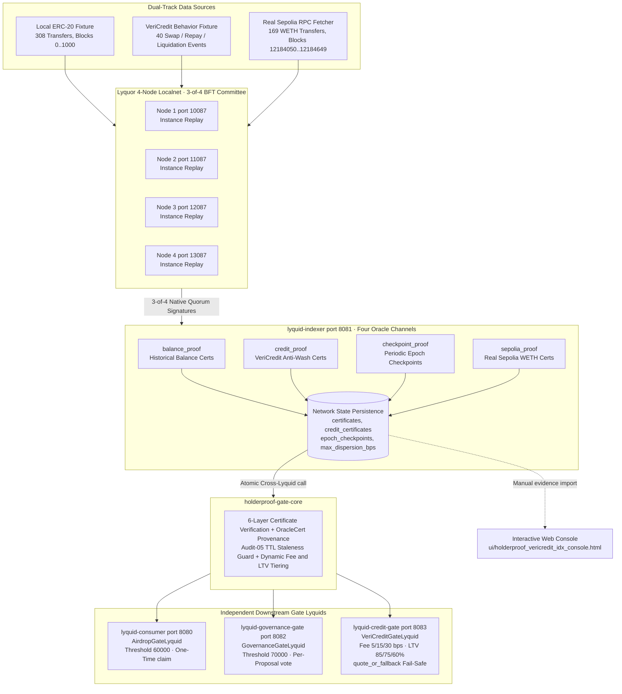
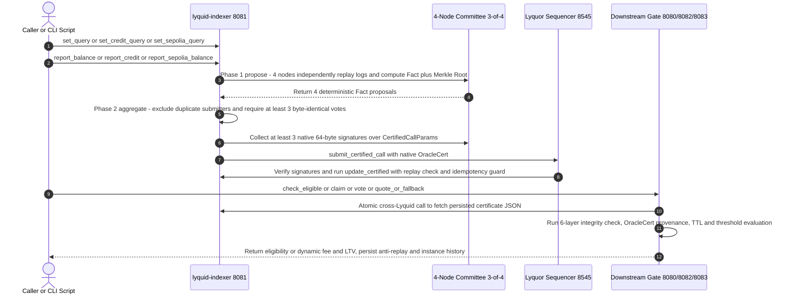
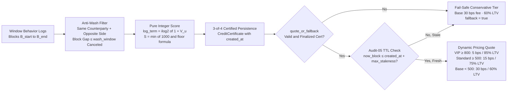

[English](README.md) | [简体中文](README.zh-CN.md)

# HolderProof & VeriCredit-Idx

A **3-of-4 Byzantine Fault Tolerant (BFT) Verifiable Historical On-Chain Indexer and Multi-Gate System** built on **Lyquor Network (LDK 0.8.4)** and **Rust (Edition 2024)**.

Four local committee nodes replay the same ordered events. When at least three agree on a full fact, Lyquor's two-phase oracle certifies it and the Indexer writes it to network state. The Airdrop and Governance gates read the same balance certificate and apply their own policies. The Credit Gate reads a credit certificate and returns a fee and loan-to-value quote.

[Course report](docs/reports/CS5298_FINAL_REPORT.md) · [Testing guide](docs/guides/TESTING.md) · [Web user guide](docs/guides/WEB_GUIDE.md)

---

## 1. Overall System Architecture

The architecture enforces a **Three-Layer State Boundary** (node-local private `Instance State` → periodic global `Epoch Checkpoints` in `Network State` → on-demand certified user cache in `Network State`) with dual-track support for both deterministic local fixtures and authentic Ethereum Sepolia RPC logs:

---

## 2. Core Features Implemented

| Module / Capability                                   | Key Engineering Highlights                                                                                                                                                                                                                                                                                                                                                                                                                                                            | Code Location                                                                                                                             |
| ----------------------------------------------------- | ------------------------------------------------------------------------------------------------------------------------------------------------------------------------------------------------------------------------------------------------------------------------------------------------------------------------------------------------------------------------------------------------------------------------------------------------------------------------------------- | ----------------------------------------------------------------------------------------------------------------------------------------- |
| **Standard BFT 3-of-4 Committee**                     | All 4 localnet nodes participate in the active committee ($N=4, f=1, 2f+1=3$); duplicate submitters are excluded before voting, and quorum requires byte-identical complete facts                                                                                                                                                                                                                                                                                                     | `holderproof-types/src/lib.rs`, `lyquid-indexer/src/models.rs`                                                                            |
| **HolderProof Historical Balance & Dual Gates**       | Deterministically replays 308 `Transfer` events into a SHA-256 Merkle-anchored `QueryCertificate`; Airdrop Gate (threshold `60,000` → `true`) and Governance Gate (threshold `70,000` → `false`) reuse the same `queryHash`; supports both locked single-user mode and multi-user `configure_policy` / `check_eligible_for`, one-time `claim()` / `vote()`, and `invalidate_certificate` revocation                                                                                   | `lyquid-indexer/`, `holderproof-gate-core/`, `lyquid-consumer/`, `lyquid-governance-gate/`                                                |
| **Periodic Global Epoch Checkpoints (Layer 2)**       | Dedicated `checkpoint_proof` oracle commits 3-of-4 certified global summaries every `250` blocks (`250 / 500 / 750 / 1000`), persisting cumulative transfer volume, unique holder count, event count, and Merkle root for zero-recomputation downstream reads                                                                                                                                                                                                                         | `lyquid-indexer/src/fixture.rs`, `scripts/verify_epoch_checkpoints.py`                                                                    |
| **VeriCredit-Idx Anti-Wash Credit & Dynamic Pricing** | Automatically strips wash-trading volume (same counterparty, opposite direction, `delta_block <= wash_window`); computes deterministic integer credit scores $S(u) \in [0, 1000]$ via `u128::ilog2`; supports default (`35/20/2/3`) and `initializer`-configurable weights; `lyquid-credit-gate` synchronously quotes dynamic DEX fees (`5/15/30 bps`) and lending LTV (`85%/75%/60%`) with `quote_or_fallback()` fail-safe on missing, revoked, or stale (Audit-05 TTL) certificates | `lyquid-indexer/src/credit.rs`, `holderproof-gate-core/src/credit.rs`, `lyquid-credit-gate/`, `scripts/verify_credit.py`                  |
| **Dual-Track Real Ethereum Sepolia Verification**     | `fetch_sepolia_logs.py` paginates authentic Sepolia WETH `Transfer` logs (`169` events across blocks `12184050..12184649`) and real block hashes; `sepolia_proof` certifies authentic chain balances (`0.002 WETH`) via 3-of-4 quorum; `holderproof-gate-core` cleanly dispatches validation by `dataset_id` without altering offline tests                                                                                                                                           | `scripts/fetch_sepolia_logs.py`, `lyquid-indexer/src/sepolia.rs`, `holderproof-gate-core/src/certificate.rs`, `scripts/verify_sepolia.py` |
| **Dual-Mechanism Security (NDSS 2026 Defense)**       | Historical queries enforce deterministic `ChainPos` binding + byte-level consensus; time-skewed observation queries enforce a Network State honest-core dispersion guard $(v_{m-f} - v_{f+1}) \times 10000 \le M \times \epsilon_{\max}$ (default `100 bps` = 1%) to defeat Byzantine outliers and leader cherry-picking                                                                                                                                                              | `lyquid-indexer/src/dispersion.rs`                                                                                                        |
| **Archival EVM Cross-Check & Web Console**            | `FixtureToken.sol` replays all 308 transfers on an isolated Anvil (Chain ID `31338`) to cross-verify 18 archival `eth_call balanceOf` snapshots; all HTTP endpoints return JSON + CORS headers, paired with a standalone 4-tab English web console (`ui/holderproof_vericredit_idx_console.html`)                                                                                                                                                                                                       | `evm/`, `scripts/verify_historical_balance.py`, `ui/holderproof_vericredit_idx_console.html`                                                                |

---

## 3. Project & Documentation Structure

| Path                      | Type                      | Responsibility                                                                                                                                                                                                     |
| ------------------------- | ------------------------- | ------------------------------------------------------------------------------------------------------------------------------------------------------------------------------------------------------------------ |
| `holderproof-types/`      | Rust `rlib`               | Runtime-independent wire types & canonical SHA-256 hashing (`QuerySpec`, `BalanceFact`, `QueryCertificate`, `CreditParams`, `CreditCertificate`, `EpochCheckpoint`)                                                |
| `holderproof-gate-core/`  | Rust `rlib`               | Shared consumer verification engine: atomic `call!` wrappers, dual-track 6-layer certificate validation, `OracleCert` provenance, VeriCredit tiering, and Audit-05 `is_stale` TTL checks (**15** Guest unit tests) |
| `lyquid-indexer/`         | Rust `cdylib + rlib`      | Core indexer: `fixture.rs`, `merkle.rs`, `models.rs`, `credit.rs`, `sepolia.rs`, `dispersion.rs`, `certificate_builder.rs`, `http_endpoints.rs`, and 4 oracle channels (**21** Guest unit tests)                   |
| `lyquid-consumer/`        | Rust `cdylib + rlib`      | `AirdropGateLyquid` (port `8080`): airdrop threshold gate, multi-user `configure_policy`/`check_eligible_for`, one-time `claim()`, and 32-entry instance history                                                   |
| `lyquid-governance-gate/` | Rust `cdylib + rlib`      | `GovernanceGateLyquid` (port `8082`): independent governance gate, multi-user mode, per-proposal `vote()` anti-replay, and instance history                                                                        |
| `lyquid-credit-gate/`     | Rust `cdylib + rlib`      | `VeriCreditGateLyquid` (port `8083`): same-call dynamic DEX fee & lending LTV gate with `quote_or_fallback()` and configurable `max_staleness` TTL                                                                 |
| `fixtures/`               | Python + JSON             | Deterministic balance fixture (`transfers.json`), VeriCredit behavior fixture (`credit_events.json`), real Sepolia WETH logs (`sepolia_transfers.json`), and ground-truth expectations                             |
| `evm/`                    | Foundry (Solidity 0.8.28) | `FixtureToken.sol` test ledger for archival `balanceOf` verification                                                                                                                                               |
| `scripts/`                | Shell + Python + JS       | Environment setup, 4-node devnet lifecycle, P0/E3/Epoch/VeriCredit/Sepolia verification suites, Sepolia RPC fetcher, and doc exporters                                                                             |
| `tests/`                  | Python `unittest`         | `test_ground_truth.py` (**6** baseline tests for determinism, block boundaries, Merkle proofs, and tamper detection)                                                                                               |
| `ui/`                     | HTML + JS                 | Zero-dependency standalone interactive English console `holderproof_vericredit_idx_console.html` (4 tabs + local evidence JSON import)                                                                                               |

---

## 4. Core Workflow Diagrams

### 4.1 3-of-4 Two-Phase Oracle Certification & Cross-Lyquid Atomic Consumption

### 4.2 VeriCredit Anti-Wash Scoring & Audit-05 TTL Fail-Safe Flow

---

## 5. Security Self-Audit & Robustness (Bonus E3)

### 5.1 Structured Security Self-Audit Matrix (Audit-01 to Audit-05)

| Audit ID     | Threat Vector                                         | Implemented Safeguard                                                                                                                                                                                                               | Verification Evidence                                                                                                         | Remaining Limitations                                                                           |
| ------------ | ----------------------------------------------------- | ----------------------------------------------------------------------------------------------------------------------------------------------------------------------------------------------------------------------------------- | ----------------------------------------------------------------------------------------------------------------------------- | ----------------------------------------------------------------------------------------------- |
| **Audit-01** | Cross-Batch & Action Replay Attack                    | Native `OracleCert` binds `lyquid_id`, `seq_id`, `epoch`, and `nonce`; immutable `certificates[query_hash]` rejects conflicting overwrites; consumer `claimed[caller]` and `voted["proposal\|caller"]` prevent action replay        | `scripts/verify_e3.py`: duplicate `claim()`/`vote()` calls strictly keep `committed_actions = 1`                              | Relies on Lyquor sequencer runtime enforcing one-time `OracleCert.nonce` consumption            |
| **Audit-02** | Sybil Duplicate Signer Forgery                        | `agreeing_proposal` excludes any node submitting more than once; `ctx.signer_node_id` enforces active-committee membership; strict deduplication in `certificate.rs`, `credit.rs`, and `dispersion.rs`                              | Guest tests: `duplicate_nodes_and_split_votes_cannot_form_quorum`, `duplicate_or_empty_signers_are_rejected`                  | Assumes committee enrollment via `configure_committee` is protected by `initializer` governance |
| **Audit-03** | Integer Overflow & Empty Window Div-by-Zero           | Zero floating-point math; all `U256`/`u128` calculations use `checked_add`/`checked_mul`/`checked_sub`; empty ranges (`end <= start`) and zero denominators (`median == 0`) return explicit errors                                  | Guest tests: `eligibility_handles_boundary_and_invalid_balance`, `twab_respects_half_open_window_and_large_gaps`              | Callers must handle explicit error returns on extreme inputs                                    |
| **Audit-04** | Byzantine Outlier & Leader Cherry-Picking (NDSS 2026) | Deterministic historical queries bind `ChainPos` for byte-level equality; time-skewed observations enforce Network State honest-core dispersion $(v_{m-f} - v_{f+1}) \times 10000 \le M \times \epsilon_{\max}$ (default `100 bps`) | Guest tests: `dispersion_guard_*` reproducing `$3,702.42` vs `$4,302.42` (single outlier filtered; 7.69% spread rejected)     | Requires standard BFT honest majority ($f < n/3$)                                               |
| **Audit-05** | Stale Historical Report Exploitation                  | `holderproof-gate-core/src/credit.rs` enforces `is_stale(now, created_at, max_staleness)`; `quote_or_fallback()` automatically reverts expired reports to conservative `Base` parameters (`30 bps / 60% LTV`)                       | Guest test: `credit_report_staleness_ttl_is_enforced` (validates exact `250` vs `251` TTL boundary and `u64::MAX` saturation) | Sudden defaults occurring within the active TTL window still require fresh re-certification     |

### 5.2 Live Fault-Tolerance, Archival EVM Cross-Check & L1 Gas Efficiency

* **3-of-4 Process-Level Fault Tolerance (`scripts/verify_committee_availability.py`)**:
  * **1 member paused (`SIGSTOP` on port `12087`)**: remaining 3 active committee members certified a `Finalized` balance proof in **0.78s** and preserved the certificate identically after `SIGCONT` recovery.
  * **2 members paused (`SIGSTOP` on ports `11087, 12087`)**: only 2 active members remained (below 3-of-4 quorum); `report_balance()` timed out at 25s (**30.2s** total observation) with **zero unauthorized certificates issued**, then automatically finalized upon recovery.
* **Independent Archival EVM Verification (`scripts/verify_historical_balance.py`)**:
  * Replayed all **308** `Transfer` events into `FixtureToken.sol` on an isolated Anvil chain (Chain ID `31338`) and verified **18** archival `eth_call balanceOf` queries against both Python ground truth and Rust certificates with 100% agreement.
* **Measured L1 Sequencer Gas Efficiency**:
  * Verified via `cast receipt`: a single `claim()` transaction on the L1 sequencer consumes only **`34,218 gas`** (~`13,218 gas` above Ethereum's `21,000` base transfer cost), as all heavy historical replay, Merkle verification, and 6-layer certificate validation execute off-L1 inside Lyquor's LVM.

---

## 6. Trust Model & Three-Layer State Boundary

| Layer                         | Storage Tier                         | Stored Data                                                                                                               | Rationale                                                                                                 |
| ----------------------------- | ------------------------------------ | ------------------------------------------------------------------------------------------------------------------------- | --------------------------------------------------------------------------------------------------------- |
| **Layer 1: Node-Private**     | `instance` state / embedded fixtures | Raw `transfers.json`, `credit_events.json`, `sepolia_transfers.json`, `proposal_cache`, bounded `result_history` (max 32) | Avoids replicating bulky raw logs across consensus state                                                  |
| **Layer 2: Global Committed** | `network` state                      | 3-of-4 committee config, VeriCredit weights, `max_dispersion_bps`, periodic `epoch_checkpoints` (every 250 blocks)        | Shared parameters and global summaries readable with zero recomputation                                   |
| **Layer 3: On-Demand Cache**  | `network` state                      | `certificates[query_hash]`, `credit_certificates[query_hash]`, `sepolia_certificates`, `claimed`/`voted` anti-replay maps | Certifies long-tail users only on demand while satisfying LDK 0.8.4's network-only `call!` atomicity rule |

**Trust Anchor**: Consumers and the Indexer operate within the same Lyquor network. Consumers anchor trust in the configured Indexer `LyquidID` plus Lyquor's native runtime `OracleCert` enforcement, verifying 6-layer structural consistency and `OracleCert` provenance (`target`, `seq_id`, `network_state_id`) without maintaining a separate detached public-key registry.

---

## 7. Quickstart, Verification Commands & HTTP APIs

### 7.1 Prerequisites & Commands

**Windows (WSL2 Ubuntu):** follow the [Windows startup guide](docs/guides/WINDOWS_WSL.md).
From the repository root, run `powershell -NoProfile -ExecutionPolicy Bypass -File .\scripts\windows\holderproof.ps1 -Action start` after setup.
The launcher also supports `setup`, `check`, `test`, `status` and `stop`, with an optional `-Distribution` name.

Run `make web` to start a fresh local devnet and open the live console at
`http://127.0.0.1:8765`. Choose a fixture holder and a block from 0 to 1000
to inspect a historical certificate. Both gate decisions are available at
their policy snapshot, block 1000. The Web guide explains the controls and
how to import saved evidence. [Web user guide](docs/guides/WEB_GUIDE.md)

Verified with Rust `1.99.0` (`wasm32-unknown-unknown`), Lyquor LDK `0.8.4`, Foundry `1.7.1`, and Python `3.10+`.

| Command                                                       | Purpose                                                                                                         |
| ------------------------------------------------------------- | --------------------------------------------------------------------------------------------------------------- |
| `./scripts/setup-env.sh --check`                              | Inspect local Rust / LDK / Foundry / Python toolchain                                                           |
| `make check && make guest-test`                               | Fast local check: Python ground truth (6 tests) + workspace compile + Rust Guest tests (**21 + 15 = 36 tests**) |
| `./scripts/stop-step4.sh && make e3`                          | Full 3-of-4 P0 acceptance + archival EVM cross-check + E3 action/revocation/SIGSTOP audit                       |
| `make epoch-check`                                           | Activate `checkpoint_proof` and commit/verify periodic epochs (`250 / 500 / 750 / 1000`)                        |
| `make credit-check`                                           | Deploy `lyquid-credit-gate` (`8083`) and verify all 4 VeriCredit personas, wash removal & custom weights        |
| `python3 scripts/fetch_sepolia_logs.py && make sepolia-check` | Fetch authentic Sepolia WETH logs and issue a 3-of-4 certified Sepolia balance proof                            |
| `./scripts/run-proof.sh --holder 0x... --block 1000`          | Submit an on-demand P0 query to the running local Indexer                                                       |
| `./scripts/stop-step4.sh`                                     | Stop all background devnet nodes and HTTP proxies                                                               |

### 7.2 Local Ports & HTTP Diagnostic Endpoints (JSON + CORS Enabled)

| Port                            | Service / Lyquid                                  | Endpoints                                                                                                             |
| ------------------------------- | ------------------------------------------------- | --------------------------------------------------------------------------------------------------------------------- |
| `8545`                          | Anvil local sequencer                             | JSON-RPC                                                                                                              |
| `10087 / 11087 / 12087 / 13087` | Lyquor 4-node localnet (3-of-4 committee)         | Node RPC / WS                                                                                                         |
| `8081`                          | `lyquid-indexer`                                  | `/api/certificate`, `/api/certified`, `/api/credit-certificate`, `/api/epoch-checkpoints`, `/api/sepolia-certificate` |
| `8080`                          | `lyquid-consumer` (`AirdropGateLyquid`)           | `/api/result`, `/api/history`                                                                                         |
| `8082`                          | `lyquid-governance-gate` (`GovernanceGateLyquid`) | `/api/result`, `/api/history`                                                                                         |
| `8083`                          | `lyquid-credit-gate` (`VeriCreditGateLyquid`)     | `/api/credit`, `/api/history`                                                                                         |

### 7.3 Machine-Verifiable Evidence Artifacts for Final Report

| Artifact Path (generated under `.run/`)           | Verified Claims Supported                                                                                             |
| ------------------------------------------------- | --------------------------------------------------------------------------------------------------------------------- |
| `.run/step4/certificate.json` & `gate-cases.json` | Native 3-of-4 `OracleCert` sample + same-certificate reuse across 4 positive/negative threshold cases                 |
| `.run/acceptance/historical-balances.json`        | 308 EVM `Transfer` logs + 18 archival `balanceOf` queries matching Python & Rust certificates                         |
| `.run/acceptance/e3-results.json`                 | All 8 E3 audit records (tx hashes, revocation blocking, `0.78s` 1-node pause certified, `30.2s` 2-node pause blocked) |
| `.run/acceptance/epoch-checkpoints.json`          | 4 periodic global Epoch Checkpoints (`250 / 500 / 750 / 1000`) with Merkle roots & holder counts                      |
| `.run/acceptance/credit-results.json`             | 4 VeriCredit personas, `2,000,000` wash volume stripped, dynamic fee/LTV quotes & custom-weight delta                 |
| `.run/acceptance/sepolia-certificate.json`        | Authentic Sepolia WETH certificate (block `12184649`, `0.002 WETH`) signed by committee nodes `[0, 1, 3]`             |

---

## 8. Limitations & Future Work

1. **In-Guest Live Sepolia RPC Ingestion**: The current Sepolia track uses an offline fetcher + reproducible replay to eliminate public RPC rate-limit flakiness during evaluation; future work can add retry-aware outbound RPC clients inside node `instance` methods for continuous live syncing.
2. **Full P1 Window Certificate Family**: `TWAB` replay and unit tests are implemented as read-only queries, while `MIN_BALANCE` and `ACTIVE_RATIO` can be integrated into the two-phase oracle pipeline using the same window pattern already proven by `VeriCredit`.
3. **Standalone L1 Solidity Verifier**: Exporting `QueryCertificate` verification to external Ethereum L1 contracts requires deploying a committee public-key registry and signature verifier on L1.
4. **Real-Time Volatility & Trimmed TWAP (`VeriRisk-Idx`)**: Building on the implemented `dispersion.rs` guard, future work can ingest live multi-venue price feeds to compute trimmed TWAP and realized variance $\sigma_{\text{realized}}^2$ for liquidation circuit breakers.
5. **External User Testing & CI**: Conduct external reproducibility walkthroughs with `ui/holderproof_vericredit_idx_console.html` and automate `make check && make guest-test` in GitHub Actions.
