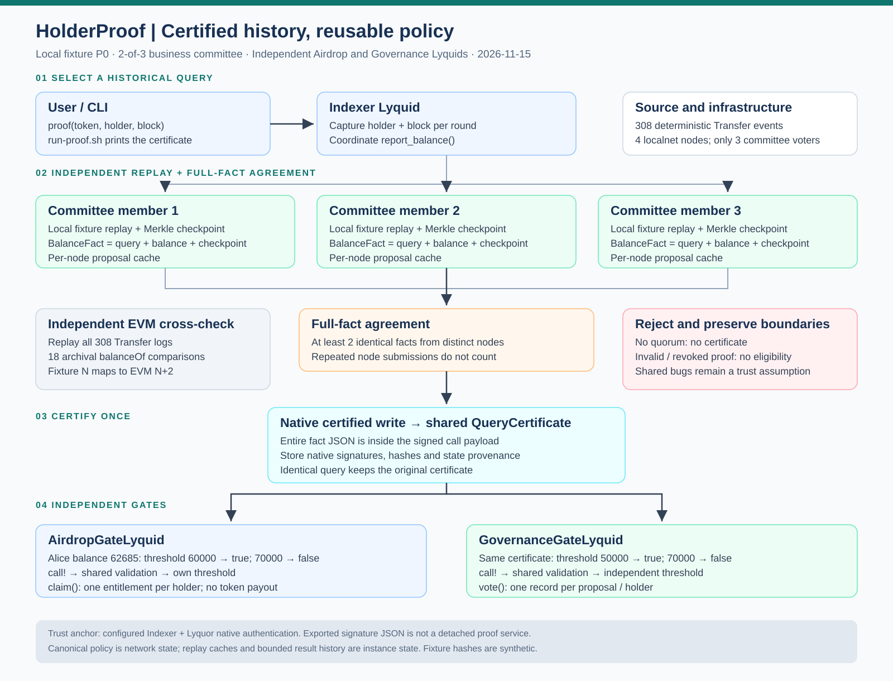

# HolderProof

Verifiable ERC-20 historical balances for airdrop and governance gating.

HolderProof replays deterministic `Transfer` history on three independent
committee members. Two matching approvals certify the complete balance fact,
including its checkpoint. Two separately deployed Lyquids consume the same
certificate with independent eligibility thresholds.

## Architecture and reading guide



[Architecture](docs/architecture/architecture.md) ·
[Code walkthrough](docs/guides/CODE_WALKTHROUGH.md) ·
[Collaboration guide](docs/guides/COLLABORATOR_GUIDE.md) ·
[Current HTML/PDF exports](docs/README.md) ·
[Rebuild documentation](docs/MAINTAINING_DOCS.md)

## Current scope

Execution-plan sections **03 and 04, P0** are implemented for the local fixture.
See [03/04 acceptance and design adaptations](docs/reports/PLAN_03_04_ACCEPTANCE.md)
for the exact evidence and differences from the proposed model.

```text
308 Transfer events
  -> three independent node replays
  -> 2-of-3 agreement on query + balance + checkpoint
  -> native Lyquor signed call
  -> persisted QueryCertificate
  -> AirdropGateLyquid (threshold 60000): true
  -> GovernanceGateLyquid (threshold 70000): false
```

Alice at fixture block 1000 has balance **62685**. Both consumers also exercise
the opposite outcome by changing their own threshold, without replacing the
certificate. Repeated identical queries return the original certificate.

Data is synthetic and local. Block hashes are deterministic fixture hashes,
not Sepolia headers. The independent EVM check replays the same transfers into
a test token and queries archival `balanceOf` state. Its contract address,
chain ID and block hashes are separate from the fixture metadata.

## Setup

Verified with Rust 1.99.0, Lyquor LDK 0.8.4, Foundry 1.7.1 and Python 3.12.

```bash
./scripts/setup-env.sh
# Inspect only:
./scripts/setup-env.sh --check
```

The first `forge build --root evm` downloads the pinned official Solidity 0.8.28
compiler. Later historical checks can run offline. The LDK guest-test VM needs
permission to initialize its memory manager.

## Testing guide

Follow the [测试操作指引](docs/guides/TESTING.md) for a first manual run, expected
certificate and gate results, automated acceptance, and troubleshooting.

## Full P0 acceptance

From this repository's root:

```bash
make acceptance
```

This runs fixture generation/checks, Python tests, Rust compilation, guest tests,
three-Lyquid deployment, both gates' positive/negative cases, repeat-query
idempotency, instance history checks, and the archival EVM comparison.

The official LDK localnet starts four infrastructure nodes; **only three are
members of HolderProof's 2-of-3 committee**. The fourth is not a committee voter.
Ports 8545, 10087, 11087, 12087, 13087, 8080, 8081 and 8082 must be available.
The archival check starts and stops its own Anvil on an available loopback port.

```bash
# Stop this demo before rerunning acceptance:
./scripts/stop-step4.sh
```

Evidence is saved under `.run/step4/` and `.run/acceptance/` (ignored by Git).
HTTP diagnostics while the demo is running:

- Indexer: `http://127.0.0.1:8081/api/certificate`
- Airdrop: `http://127.0.0.1:8080/api/result`
- Governance: `http://127.0.0.1:8082/api/result`
- Per-instance result history: `/api/history` on either gate

## E3 自审计

`make e3` 在空闲端口启动全新的本地 demo，运行 P0 验收，再验证资格动作、权限、证书撤销和委员会暂停恢复。
该目标会改变 demo 的 Gate 配置及证书状态。结束后可用 `./scripts/stop-step4.sh` 停止。
测试覆盖和证据见 [方案 05 自审计记录](docs/reports/PLAN_05_E3_AUDIT.md)。

## Individual commands

```bash
make check
make guest-test
make historical-check
./scripts/reproduce-step4.sh
python3 scripts/verify_step4.py
# Changes only local demo gate policies to exercise positive/negative cases:
python3 scripts/verify_step4.py --exercise-gates

./scripts/run-proof.sh \
  --token 0x5298000000000000000000000000000000000001 \
  --holder 0xaaaaaaaaaaaaaaaaaaaaaaaaaaaaaaaaaaaaaaaa \
  --block 1000
```

`run-proof.sh` requires a running, configured demo. It supports the fixture token,
a nonzero holder and finalized fixture blocks 0..1000. The default signing key
is a public disposable Anvil key. `HOLDERPROOF_DEV_KEY` overrides it for another
local development account. Unsupported inputs are rejected explicitly.

The airdrop deployment lives in `lyquid-consumer/` for compatibility with earlier
scripts. Its `claim()` records one entitlement per holder. The governance
Lyquid's `vote()` records one vote per proposal/holder. Both bind the action to
the caller and recheck the certificate. These are qualification gates; the demo
does not distribute tokens or implement a complete DAO voting system.

## Source layout

| Path | Responsibility |
|---|---|
| `holderproof-types/` | Fact, checkpoint, certificate and query hashing |
| `lyquid-indexer/` | Replay, checkpoint, full-fact quorum, certified writes |
| `holderproof-gate-core/` | Shared certificate, provenance and threshold rules |
| `lyquid-consumer/` | AirdropGateLyquid, entitlement records, local history |
| `lyquid-governance-gate/` | Independent governance policy and vote records |
| `fixtures/` | Deterministic events and independent Python answers |
| `evm/` | Test-only ledger for archival `balanceOf` verification |
| `scripts/` | Setup, querying, reproduction and acceptance |

## Trust and state model

The configured Indexer and Lyquor runtime authenticate certified writes.
Certificates include native `OracleCert` data, signer IDs/signature bytes,
query/fact hashes and network-state provenance. Consumers validate consistency
and source identity; they do not independently authenticate detached signature
strings against a separate committee registry. See the
[certificate rules](docs/operations/step4-certificate.md).

Canonical policy and action records remain in network state because LDK 0.8.4
allows atomic `call!` only in network methods. Per-node replay caches and bounded
consumer result histories use instance state. Raw fixture data is embedded
locally. This is an explicit implementation adaptation of the plan's state table.

P1 already has TWAB replay, but MIN_BALANCE, ACTIVE_RATIO and historical-window
certificates are outside P0. Sepolia ingestion, external user testing, UI, final
report and recorded demo remain separate work.

[Documentation index](docs/README.md) ·
[Progress](docs/progress/PROJECT_PROGRESS.md) ·
[Original scenario plan](docs/reports/HolderProof_Scenario1_Plan.pdf)

Earlier dated PDFs and operation records document their historical versions.
