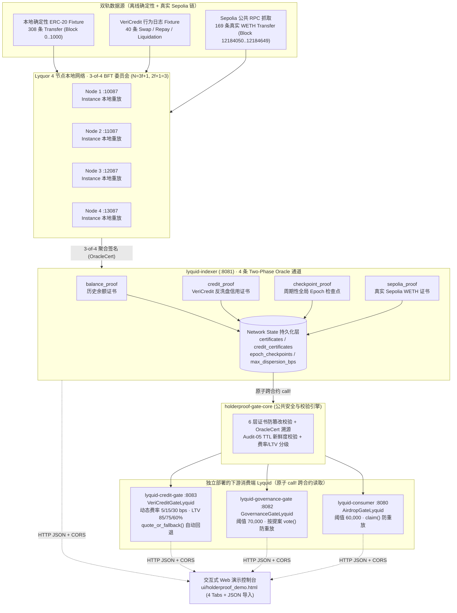
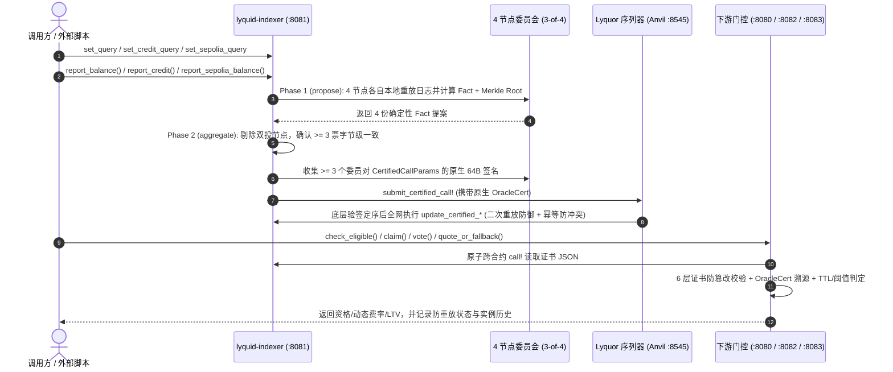
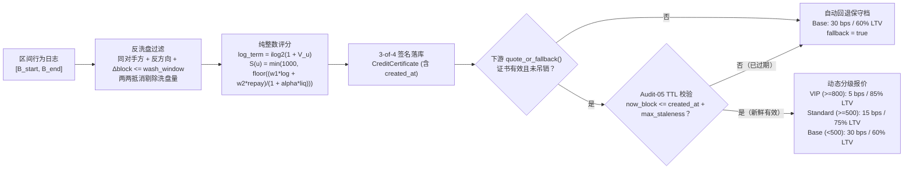

# HolderProof & VeriCredit-Idx

基于 **Lyquor Network（LDK 0.8.4）** 与 **Rust（Edition 2024）** 构建的 **3-of-4 拜占庭容错（BFT）可验证历史链上索引器与多场景门控系统**。

系统通过 4 个独立委员会节点确定性重放历史链上事件，采用 **$N = 3f + 1 = 4$、法定人数 $2f + 1 = 3$** 的原生两阶段预言机（Two-Phase Oracle）协议对完整事实与 Merkle Root 检查点达成背书并持久化到全网状态；下游多个独立部署的消费端 Lyquid（空投门控、治理门控、动态费率与借贷 LTV 门控）在同一次原子调用（`call!`）中直接读取并校验同一份证书，实现**无需链下 ZK 证明延迟的链上历史可验证计算与跨应用复用**。

---

## 1. 项目总体架构图

系统严格遵循 **三级分层状态边界（Instance 本地私有 → Network 周期公共检查点 → Network 按需个体证书缓存）**，同时支持本地确定性数据与真实以太坊 Sepolia 链双轨接入：

---

## 2. 已实现核心功能

| 模块 / 能力 | 核心实现亮点 | 对应代码位置 |
|---|---|---|
| **标准 BFT 3-of-4 委员会** | 4 个本地节点全部纳入委员会（$N=4, f=1, 2f+1=3$）；剔除重复提交节点防双投，全量事实字节级一致方可出证 | `holderproof-types/src/lib.rs`, `lyquid-indexer/src/models.rs` |
| **HolderProof 历史余额与双门控** | 确定性重放 308 条 `Transfer` 生成带 SHA-256 Merkle Root 的 `QueryCertificate`；空投门控（60,000 → `true`）与治理门控（70,000 → `false`）复用同一 `queryHash`，支持单用户与 `configure_policy` / `check_eligible_for` 多用户模式、防重放 `claim()` / `vote()` 及 `invalidate_certificate` 吊销 | `lyquid-indexer/`, `holderproof-gate-core/`, `lyquid-consumer/`, `lyquid-governance-gate/` |
| **周期性全局检查点（Layer 2）** | `checkpoint_proof` 通道按 `epoch_interval = 250` 块（`250 / 500 / 750 / 1000`）周期性提交 3-of-4 背书的全局检查点（累计交易量、活跃地址数、事件数、摘要根），供下游零重算直读 | `lyquid-indexer/src/fixture.rs`, `scripts/verify_epoch_checkpoints.py` |
| **VeriCredit-Idx 信用评分与动态费率** | 自动剔除短窗口同对手方反向对敲洗盘量；用纯整数 `u128::ilog2` 计算 $S(u) \in [0, 1000]$；支持默认权重（`35/20/2/3`）与 `initializer` 自定义配置；下游 `lyquid-credit-gate` 同步返回动态费率（`5/15/30 bps`）与借贷 LTV（`85%/75%/60%`），并提供 `quote_or_fallback()` 在证书缺失/吊销/超期（Audit-05 TTL）时自动回退保守档 | `lyquid-indexer/src/credit.rs`, `holderproof-gate-core/src/credit.rs`, `lyquid-credit-gate/`, `scripts/verify_credit.py` |
| **真实 Sepolia 链双轨接入** | `fetch_sepolia_logs.py` 从公共 Sepolia RPC 分页拉取官方 WETH 合约 169 条真实 `Transfer` 日志与真实区块头哈希（块 `12184050..12184649`）；`sepolia_proof` 通道走 3-of-4 签发真实链证书（余额 `0.002 WETH`），消费端按 `dataset_id` 双轨分流校验 | `scripts/fetch_sepolia_logs.py`, `lyquid-indexer/src/sepolia.rs`, `holderproof-gate-core/src/certificate.rs`, `scripts/verify_sepolia.py` |
| **双重安全防线（NDSS 2026 防御）** | 确定性历史查询采用 `ChainPos` 区块锚定 + 字节级全等；时间差观测查询在 Network State 实现诚实核心区间离散度校验 $(v_{m-f} - v_{f+1}) \times 10000 \le M \times \epsilon_{\max}$（默认 `100 bps` = 1%），抵御单节点极端值与 Leader 挑拣攻击 | `lyquid-indexer/src/dispersion.rs` |
| **独立 EVM 归档对账与 Web 控制台** | `FixtureToken.sol` 在独立 Anvil（Chain ID `31338`）重放 308 笔转账并核对 18 组归档 `eth_call balanceOf`；全部 HTTP 诊断接口均带 `content-type` 与 CORS 头，配套全英文 4 标签页交互演示台 `holderproof_demo.html` | `evm/`, `scripts/verify_historical_balance.py`, `ui/holderproof_demo.html` |

---

## 3. 项目代码与文档结构

| 目录 / 文件 | 类型 | 职责说明 |
|---|---|---|
| `holderproof-types/` | Rust `rlib` | 跨模块线协议类型与哈希规则（`QuerySpec`、`BalanceFact`、`QueryCertificate`、`CreditParams`、`CreditCertificate`、`EpochCheckpoint` 等） |
| `holderproof-gate-core/` | Rust `rlib` | 消费端公共安全引擎：跨 Lyquid `call!` 封装、双轨 6 层证书校验、`OracleCert` 溯源、VeriCredit 分级与 Audit-05 `is_stale` TTL 校验（含 **15 项** Guest 单测） |
| `lyquid-indexer/` | Rust `cdylib + rlib` | 核心索引器：含 `fixture.rs`、`merkle.rs`、`models.rs`、`credit.rs`、`sepolia.rs`、`dispersion.rs`、`certificate_builder.rs`、`http_endpoints.rs` 及 4 条 Oracle 通道（含 **21 项** Guest 单测） |
| `lyquid-consumer/` | Rust `cdylib + rlib` | `AirdropGateLyquid`（端口 `8080`）：空投阈值门控、多用户 `configure_policy`/`check_eligible_for`、防重放 `claim()` 与 32 条实例历史 |
| `lyquid-governance-gate/` | Rust `cdylib + rlib` | `GovernanceGateLyquid`（端口 `8082`）：治理提案门控、多用户模式、按 `proposal_id` 防重放 `vote()` 与实例历史 |
| `lyquid-credit-gate/` | Rust `cdylib + rlib` | `VeriCreditGateLyquid`（端口 `8083`）：同调用读取信用分并返回动态 DEX 费率与 LTV，支持 `quote_or_fallback()` 与 `max_staleness` TTL 兜底 |
| `fixtures/` | Python + JSON | 确定性余额数据（`transfers.json`）、VeriCredit 行为数据（`credit_events.json`）、真实 Sepolia WETH 日志（`sepolia_transfers.json`）及对应基准答案 |
| `evm/` | Foundry (Solidity 0.8.28) | `FixtureToken.sol`，用于独立 Anvil 归档 `balanceOf` 正确性交叉验证 |
| `scripts/` | Shell + Python + JS | 环境安装、4 节点 Devnet 起停、P0/E3/周期检查点/VeriCredit/Sepolia 自动化验收脚本、Sepolia RPC 抓取工具与文档导出工具 |
| `tests/` | Python `unittest` | `test_ground_truth.py`（**6 项**基准单测：确定性生成、边界包含、Merkle 证明与篡改检测） |
| `ui/` | HTML + JS | 零依赖单文件全英文交互控制台 `holderproof_demo.html`（4 个标签页 + 本地证据 JSON 导入） |

---

## 4. 主要流程流程图

### 4.1 3-of-4 两阶段预言机出证与跨 Lyquid 原子消费流程

### 4.2 VeriCredit 反洗盘评分与 Audit-05 TTL 自动回退流程

---

## 5. 安全自审计与鲁棒性验证（Bonus E3）

### 5.1 结构化五项安全自审计矩阵（Audit-01 ~ Audit-05）

| 审计编号 | 威胁模型与攻击面 | 代码级安全防护实现 | 自动化测试与实测证据 | 剩余局限与信任假设 |
|---|---|---|---|---|
| **Audit-01** | 跨批次签名重放与重复领/投 | Lyquor 原生 `OracleCert` 绑定 `lyquid_id + seq_id + epoch + nonce`；Indexer `certificates[query_hash]` 拦截冲突覆盖；消费端 `claimed[caller]` 与 `voted["proposal\|caller"]` 严格防重放 | `scripts/verify_e3.py`：连续提交重复 `claim()`/`vote()`，最终 `committed_actions` 严格为 `1` | 依赖 Lyquor 序列器对 `OracleCert.nonce` 的底层一次性校验 |
| **Audit-02** | 女巫重复签名伪造法定人数 | `models.rs` 的 `agreeing_proposal` 剔除提交超 1 次的节点；`lib.rs` 查 `ctx.signer_node_id` 确认活跃委员身份；`certificate.rs` / `credit.rs` / `dispersion.rs` 全程去重 | Guest 单测：`duplicate_nodes_and_split_votes_cannot_form_quorum`、`duplicate_or_empty_signers_are_rejected` | 假设委员会成员注册过程受 `initializer` 治理保护 |
| **Audit-03** | 整数算术溢出与空窗口除零 | 全项目禁用浮点数，统一采用 `U256`/`u128` 的 `checked_add`/`checked_mul`/`checked_sub`；空区间（`end <= start`）与零分母（`median == 0`）显式返回错误而非 panic | Guest 单测：`eligibility_handles_boundary_and_invalid_balance`、`twab_respects_half_open_window_and_large_gaps` | 极值被安全拒绝后需由调用方处理错误返回 |
| **Audit-04** | 拜占庭离群值投毒与 Leader 挑拣（NDSS 2026） | 确定性历史查询采用 `ChainPos` 锚定 + 字节级全等；时间差观测查询在 Network State 强制校验 $(v_{m-f} - v_{f+1}) \times 10000 \le M \times \epsilon_{\max}$（默认 `100 bps`） | Guest 单测：`dispersion_guard_*` 复现 `$3,702.42` vs `$4,302.42` 场景（单异常值自动滤除，7.69% 宽分叉直接拒绝） | 需满足标准 BFT 诚实多数假设（$f < n/3$） |
| **Audit-05** | 过期历史报告越权消费（Stale Report） | `holderproof-gate-core/src/credit.rs` 提供 `is_stale(now, created_at, max_staleness)`；`lyquid-credit-gate` 在 `quote_or_fallback` 中强制检查新鲜度，超期自动回退至保守档（`30 bps / 60% LTV`） | Guest 单测：`credit_report_staleness_ttl_is_enforced`（精确验证边界 `250` 有效、`251` 过期与 `u64::MAX` 防溢出） | TTL 窗口内的极短期突发违约仍需触发重算更新 |

### 5.2 真实进程级容错、EVM 对账与 Gas 效率实测数据

* **3-of-4 进程级宕机容错（`scripts/verify_committee_availability.py`）**：
  * 使用 `SIGSTOP` 暂停 1 个委员（端口 `12087`）：剩余 3 个委员在 **0.78 秒** 内正常签发 `Finalized` 证书，`SIGCONT` 恢复后幂等保留原证书。
  * 同时暂停 2 个委员（端口 `11087, 12087`）：仅剩 2 个活跃节点（不足 3-of-4 阈值），`report_balance` 等待 25 秒超时（总观测 **30.2 秒**），确认暂停期间**零违规出证**；恢复节点后自动收敛并签发出证。
* **独立以太坊 EVM 归档对账（`scripts/verify_historical_balance.py`）**：
  * 在独立 Anvil（Chain ID `31338`）部署 `FixtureToken.sol`，逐块重放全部 **308 笔** `Transfer` 并核对 **18 组** 归档 `eth_call balanceOf`，与 Python 基准及 Rust 认证证书 100% 一致。
* **L1 序列层 Gas 开销实测**：
  * 经 `cast receipt` 实测，单次门控动作 `claim()` 在 L1 序列器仅消耗 **`34,218 gas`**（扣除以太坊 `21,000` 起步价后合约桥接日志开销仅约 `13,218 gas`），所有重型历史重放与 6 层证书校验均在 Lyquor LVM 完成，显著低于纯 Solidity 方案。

---

## 6. 信任模型与三级状态边界

| 状态层 | 存储位置 | 存放内容 | 设计理由 |
|---|---|---|---|
| **Layer 1：节点本地私有** | `instance` state / 编译期嵌入 | 原始 `transfers.json`、`credit_events.json`、`sepolia_transfers.json`、`proposal_cache`、`result_history`（上限 32 条） | 避免将海量原始日志写入全网共识造成无意义复制开销 |
| **Layer 2：全网周期公共** | `network` state | 3-of-4 委员会配置、VeriCredit 权重、`max_dispersion_bps`、周期性 `epoch_checkpoints`（每 250 块） | 公共参数与全局摘要一次提交、全网零重算直读 |
| **Layer 3：按需个体缓存** | `network` state | `certificates[query_hash]`、`credit_certificates[query_hash]`、`sepolia_certificates`、`claimed`/`voted` 防重放表 | 仅对被查询的用户按需出证并持久化，满足 LDK 0.8.4 `call!` 仅限网络方法的原子性要求 |

**信任锚点**：消费端与 Indexer 运行在同一条 Lyquor 网络内，以 **配置好的正牌 Indexer `LyquidID` + Lyquor 运行时原生 `OracleCert` 认证机制** 为信任锚点；消费端严格校验 6 层结构自洽性与 `OracleCert` 的 `target`/`seq_id`/`network_state_id` 归属，而无需维护独立的外部公钥注册表。

---

## 7. 快速开始、验收命令与端口索引

### 7.1 环境要求与一键命令

已验证环境：Rust `1.99.0`（含 `wasm32-unknown-unknown`）、Lyquor LDK `0.8.4`、Foundry `1.7.1`、Python `3.10+`。

| 命令 | 作用说明 |
|---|---|
| `./scripts/setup-env.sh --check` | 检查本地 Rust / LDK / Foundry / Python 环境 |
| `make check && make guest-test` | 秒级本地自检：Python 基准（6 项）+ 全量编译 + Rust Guest 单测（**21 + 15 = 36 项**） |
| `./scripts/stop-step4.sh && make e3` | 完整 P0 3-of-4 验收 + 独立 EVM 归档对账 + E3 动作/吊销/节点宕机自审计 |
| `python3 scripts/verify_epoch_checkpoints.py` | 激活 `checkpoint_proof` 并提交验证 `250 / 500 / 750 / 1000` 四个周期检查点 |
| `make credit-check` | 部署 `lyquid-credit-gate`（`8083`）并验证 4 个画像、反洗盘与自定义权重权限 |
| `python3 scripts/fetch_sepolia_logs.py && make sepolia-check` | 从真实 Sepolia RPC 拉取 WETH 日志并通过 3-of-4 委员会签发真实链证书 |
| `./scripts/run-proof.sh --holder 0x... --block 1000` | 对运行中的本地 Indexer 发起任意合规地址/区块的按需出证 |
| `./scripts/stop-step4.sh` | 停止后台 4 节点与 HTTP 代理并释放端口 |

### 7.2 本地端口与 HTTP 诊断接口（均支持 JSON + CORS）

| 端口 | 服务 / Lyquid | HTTP 端点 |
|---|---|---|
| `8545` | Anvil 本地以太坊序列器 | JSON-RPC |
| `10087 / 11087 / 12087 / 13087` | Lyquor 4 节点本地网（3-of-4 委员） | Node RPC / WS |
| `8081` | `lyquid-indexer` | `/api/certificate`、`/api/certified`、`/api/credit-certificate`、`/api/epoch-checkpoints`、`/api/sepolia-certificate` |
| `8080` | `lyquid-consumer` (`AirdropGateLyquid`) | `/api/result`、`/api/history` |
| `8082` | `lyquid-governance-gate` (`GovernanceGateLyquid`) | `/api/result`、`/api/history` |
| `8083` | `lyquid-credit-gate` (`VeriCreditGateLyquid`) | `/api/credit`、`/api/history` |

### 7.3 可直接写入最终报告的机器验收证据清单

| 证据文件路径（运行后自动生成于 `.run/`） | 证明内容 |
|---|---|
| `.run/step4/certificate.json` & `gate-cases.json` | 3-of-4 原生 `OracleCert` 样本 + 同一证书在双门控 4 组正反阈值下的复用结果 |
| `.run/acceptance/historical-balances.json` | 308 条 EVM `Transfer` log + 18 组归档 `balanceOf` 与 Rust 证书三方对账证据 |
| `.run/acceptance/e3-results.json` | E3 全部 8 项回归证据（含真实交易哈希、吊销拦截、`SIGSTOP` 0.78s 出证 / 30.2s 阻塞恢复） |
| `.run/acceptance/epoch-checkpoints.json` | 4 个周期性全局检查点（`250 / 500 / 750 / 1000`）及其 Merkle Root 与活跃统计 |
| `.run/acceptance/credit-results.json` | VeriCredit 4 个用户画像、反洗盘 200 万剔除、动态费率/LTV 与自定义权重对比证据 |
| `.run/acceptance/sepolia-certificate.json` | 真实 Sepolia 官方 WETH（块 `12184649`，`0.002 WETH`）由 `[0, 1, 3]` 节点签发的真实链证书 |

---

## 8. 已知局限与未来改进方向

1. **节点运行期实时直连外部 RPC**：当前 Sepolia 轨道采用“离线抓取脚本 + 本地可复现重放”双轨方案以规避公共 RPC 限流风险；后续可在节点 `instance` 方法中引入带重试与多源负载均衡的出站 RPC 客户端，实现无人值守实时同步。
2. **完整 P1 持仓窗口证书族**：`lyquid-indexer` 已完成 `TWAB` 只读算法与单测，但 `MIN_BALANCE` 与 `ACTIVE_RATIO` 尚未接入委员会出证；后续可沿用 `VeriCredit` 的窗口证书模式无缝并入 `QueryType`。
3. **跨链 L1 独立验签合约**：当前消费端依托 Lyquor 同一网络内的 `call!` 信任锚点；若未来需将 `QueryCertificate` 交付给以太坊主网 Solidity 合约消费，可在 L1 部署维护委员会公钥集合的独立密码学验签器。
4. **实时多源价格风控场景（VeriRisk-Idx）**：目前 `dispersion.rs` 已完成核心离散度校验器与单测，未来可接入多 DEX/CEX 实时行情源实现截尾 TWAP 与实现波动率 $\sigma_{\text{realized}}^2$ 清算熔断。
5. **外部用户测试与自动化 CI**：结合 `ui/holderproof_demo.html` 开展外部用户复现测试，并将 `make check && make guest-test` 接入 GitHub Actions 持续集成。
