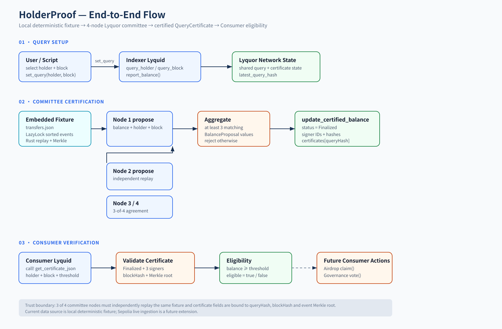
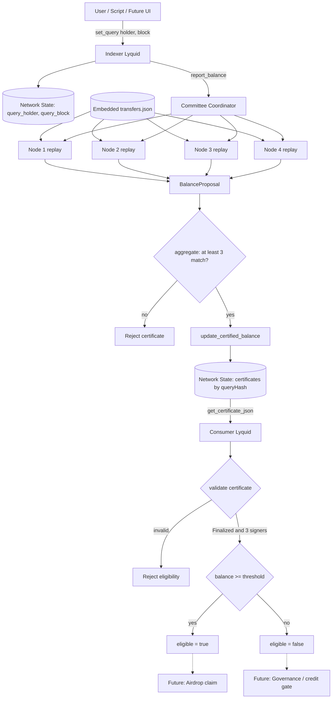
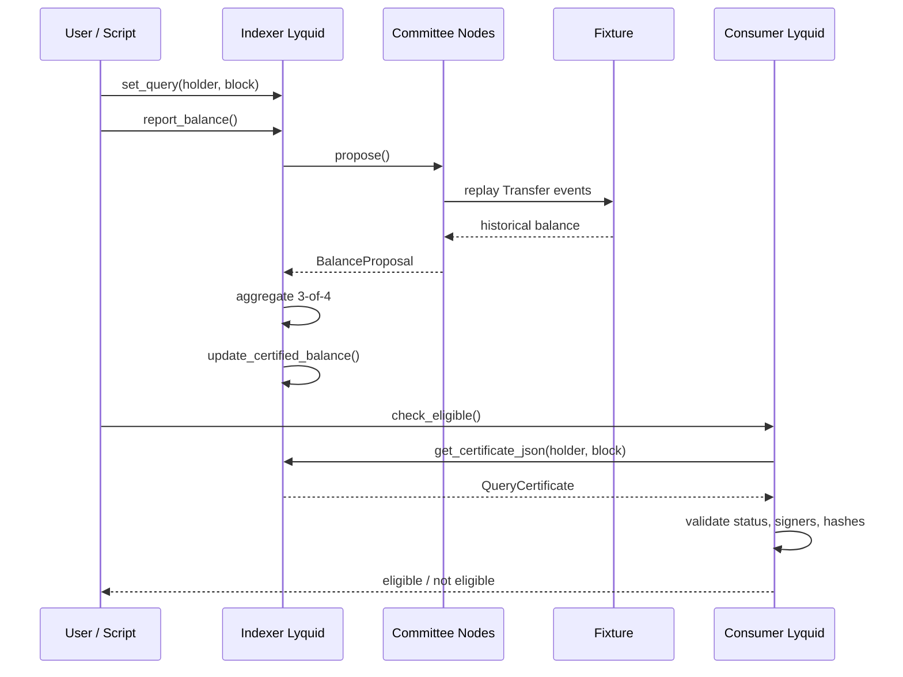

# HolderProof Architecture Notes

## P0 flow

1. User requests `proof(token, holder, blockN)`.
2. Four index nodes independently replay `Transfer` events through `blockN`.
3. Each node returns `balance + blockHash + eventRoot + signature`.
4. The coordinator accepts a result only when at least 3 of 4 nodes agree.
5. A certificate is written to shared Lyquor state.
6. The Consumer Lyquid reads the finalized certificate and returns eligibility. Separate AirdropGateLyquid and GovernanceGateLyquid are planned next.

## State split

| Layer | Contents |
|---|---|
| Network state | certificate, query hash, block hash, event root, signatures, finality status |
| Instance state | token, holder, requested block, threshold, eligibility result |
| Node-private state | raw events, local index, replay cache, node key |
| Off-chain data | complete raw logs required for independent replay and audit |

## Certificate sketch

```text
HolderProofCertificate {
  certificateId,
  chainId,
  token,
  holder,
  blockNumber,
  blockHash,
  threshold,
  balance,
  eventMerkleRoot,
  queryHash,
  parserVersion,
  nodeSignatures[],
  networkStateId,
  status,
  createdAt
}
```

## Trust assumptions

- 3 of 4 nodes are independent and do not collude (`n/2 + 1`).
- Nodes can access complete Transfer history for the requested range.
- All nodes do not share the same undiscovered implementation bug.
- The certificate is bound to a finalized block hash, not only a block number.

The committee-rerun design is a practical middle ground between centralized
indexers and ZK proofs. It must not be described as a mathematical proof.

## End-to-end flow





## Query sequence



> GitHub renders these Mermaid diagrams directly. Keep the diagram source in this file so it remains reviewable and updatable.
