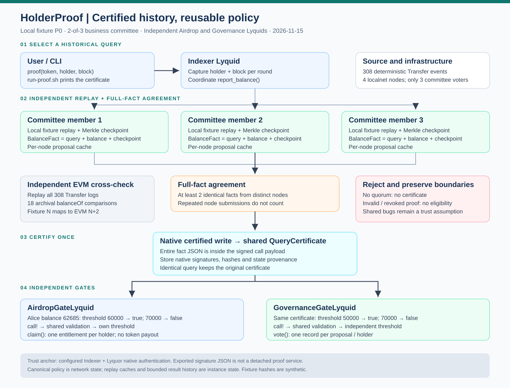
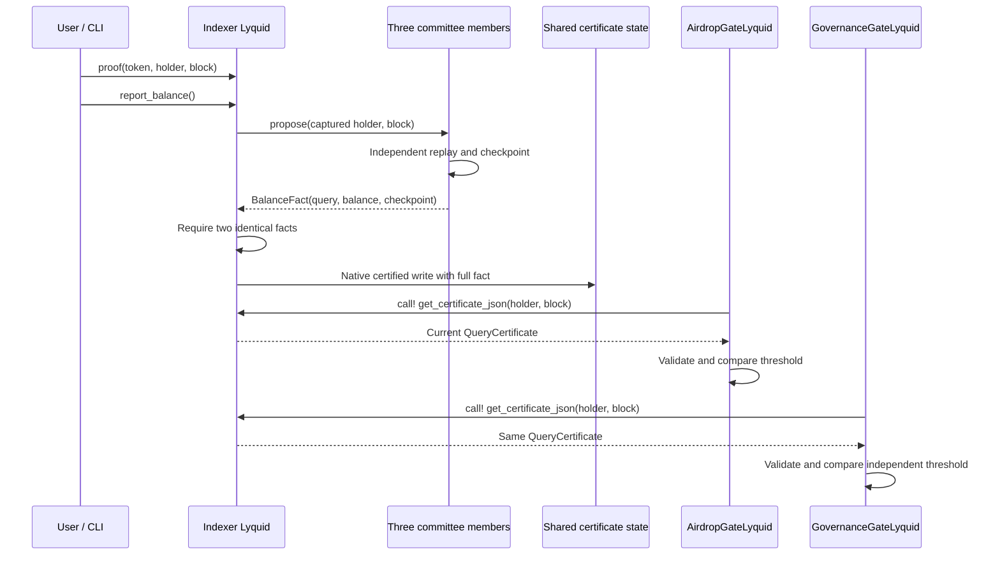

# HolderProof 架构与端到端流程

更新日期：2026-11-15。对应执行方案 03/04 的本地 fixture P0。

系统将历史余额事实交给三个委员会成员独立重算，由两份一致的批准完成原生认证。
同一份证书由空投和治理两个独立 Lyquid 消费；门槛属于各自策略，不写入持仓事实。



## 1. 组件及职责

| 组件 | 当前职责 |
|---|---|
| 查询 CLI | `run-proof.sh --token --holder --block` 选择查询、等待生效、请求认证并返回证书 |
| Indexer Lyquid | 固定轮次查询参数，协调委员会，存储和读取当前证书状态 |
| 三成员委员会 | 各自重放 Transfer、生成完整 BalanceFact，要求两份事实完全一致 |
| Lyquor 原生认证 | 对完整事实所在的认证调用载荷签名，并验证认证写入 |
| 共享校验库 | 校验来源、状态、查询身份、事实哈希、checkpoint 与签名证据一致性 |
| AirdropGateLyquid | 独立资格门槛；`claim()` 记录一次领取资格，不执行代币支付 |
| GovernanceGateLyquid | 独立治理门槛；`vote()` 记录每个提案和持有者的一次投票 |
| 历史 EVM 对照 | 在隔离 Anvil 重放同批事件，再读取历史 `balanceOf` 验证余额 |

官方 localnet 启动四个基础设施节点，HolderProof 只选前三个组成业务委员会。
第四个基础设施节点不参与该委员会投票。应用规则是 **2-of-3**。

## 2. 查询与认证时序



签名轮次捕获查询参数，轮次开始后修改所选查询不会改变其含义。
聚合比较完整事实：余额相同但区块哈希、事件根、数据集或查询对象不同，不能合并为一致结果。
重复节点不计入投票；重复相同查询保留原证书及其创建位置。

## 3. 状态分层

| 层次 | 实际保存的内容 |
|---|---|
| Network State | 委员会策略、所选查询、证书、当前状态、两个 Gate 的权威策略与动作记录 |
| Indexer Instance State | 各节点的完整提案缓存 `proposal_cache` |
| Gate Instance State | 各自最多 32 条查询与结果历史，通过 `/api/history` 查看 |
| 节点本地数据 | 内嵌 fixture、排序后的事件缓存；密钥由 Lyquor 运行时管理 |
| 离线审计材料 | Python 标准答案、EVM 对照、验收日志及 JSON 结果 |

LDK 0.8.4 的原子跨 Lyquid `call!` 只能在 network 方法内执行。
因此权威策略和动作结果保留在 Network State，Instance State 用于本地缓存和诊断历史。
这是对执行方案状态表的明确适配，不宣称已实现不存在的运行时接口。

## 4. 证书及信任边界

`QueryCertificate` 包含查询身份、完整事实哈希、checkpoint、余额、原生签名证据、
`network_state_id`、状态和创建位置。`checkpoint.block_hash` 表示查询结束区块，
`block_hash_start` 表示起始区块；当前起点是 fixture 的区块 0。

| 标识或字段 | 含义 |
|---|---|
| `query_hash` / `certificate_id` | 查询身份，用于查找；P0 查询类型固定为 Balance |
| `fact_hash` | 完整查询、查询类型、余额和 checkpoint 的一致性摘要 |
| `runtime_certificate` | 原始原生 OracleCert，包括 header、签名者索引及签名字节 |
| `node_signatures` | 原生签名者索引到节点 ID、签名字节的可读映射 |
| `network_state_id` | `LyquidID@creation_block` 来源引用，不是状态包含证明 |
| `status` | 当前是否 Finalized；管理员可将已存证书置为 Invalidated |

可信来源是管理员配置的 Indexer 和 Lyquor 原生认证路径。
消费者核对导出的证据一致性与来源，但不维护独立密钥注册表来验证任意脱离运行时的签名 JSON。
委员会重算不是数学证明；所有成员共用实现仍有共同缺陷风险。

## 5. 当前演示与独立对照

Alice 在 fixture 区块 1000 的余额为 **62685**。

| 消费者 | 策略门槛 | 结果 |
|---|---|---|
| 空投 | 60000 | 合格 |
| 空投 | 70000 | 不合格 |
| 治理 | 50000 | 合格 |
| 治理 | 70000 | 不合格 |

四个结果复用同一证书。验收同时检查证书未被消费者修改、重复查询幂等，以及实例历史有记录。
资格正反结果已完成网络演示；完整支付或 DAO 执行系统不在本次验收范围。

历史对照重放 308 条真实 EVM Transfer 日志，验证 18 次历史 `balanceOf` 查询。
测试合约部署占用区块 1，因此 fixture 区块 N 映射到 EVM 区块 N+2。
EVM 地址、链 ID 和哈希与合成 fixture 元数据不同；此对照验证余额正确性，不验证 Sepolia 链头。

## 6. 验收和后续范围

```bash
make acceptance
./scripts/stop-step4.sh
```

P0 限定一个 fixture Token、一个持有者、区块 0..1000 的单点余额。
已有 TWAB 重放属于 P1；MIN_BALANCE、ACTIVE_RATIO、窗口证书、Sepolia 接入、
完整 E3 故障注入、外部用户测试、UI 和最终演示交付仍是后续工作。

详细结果见 [03/04 验收记录](../reports/PLAN_03_04_ACCEPTANCE.md)。
