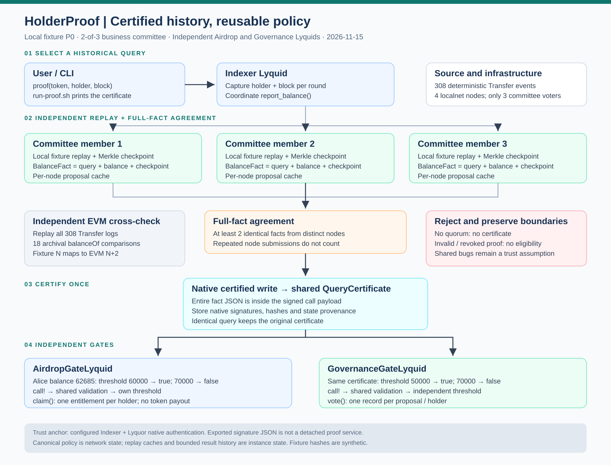

# HolderProof 代码导读

更新日期：2026-11-15。建议按“数据结构、重放、共识、证书、消费者、验收”的顺序阅读。
内部历史 Step 编号与执行方案 03/04 章节号不同；当前实现范围为本地 fixture P0。



## 1. 先认识三个边界

Network 方法读写共享的权威状态。Instance 方法管理节点本地缓存与历史；
LDK 0.8.4 的原子跨 Lyquid `call!` 只能在 Network 方法中使用。

三个业务委员会成员各自重算，一致门槛为 **2-of-3**。
官方 localnet 的第四个基础设施节点不是委员会成员。

签名认证由 Lyquor 原生运行时完成。导出的 JSON 保留证据，不能仅凭签名字符串的存在判断真实性。

## 2. 文件职责与阅读顺序

| 阅读入口 | 要理解的内容 |
|---|---|
| `holderproof-types/src/lib.rs` | TransferEvent、QuerySpec、BalanceFact、Checkpoint、QueryCertificate，以及共享常量 |
| `lyquid-indexer/src/fixture.rs` | fixture 校验、确定性排序、余额和 TWAB 重放、完整事实构造 |
| `lyquid-indexer/src/merkle.rs` | 事件叶子与 Merkle 根，保持 Python/Rust 字段顺序一致 |
| `lyquid-indexer/src/models.rs` | 完整事实相等、排除重复节点、选择达到门槛的一致事实 |
| `lyquid-indexer/src/lib.rs` | 查询选择、原生委员会协调、认证提交、存储、读取与撤销 |
| `lyquid-indexer/src/certificate_builder.rs` | 将已认证的事实和签名证据装配为证书，不操作共享状态 |
| `holderproof-gate-core/src/` | 两个消费者共享的配置权限、证书信任规则、余额比较 |
| `lyquid-consumer/src/lib.rs` | AirdropGateLyquid，沿用原目录以兼容已有部署脚本 |
| `lyquid-governance-gate/src/lib.rs` | 独立治理策略、资格检查与投票资格记录 |
| `scripts/run_proof.py` | CLI 参数验证、提交查询、等待证书，主函数只编排流程 |

## 3. 一次查询如何运行

用户运行以下命令，CLI 先确认 Token、持有者和区块范围，再等待所选查询在 Indexer 中生效。

```bash
./scripts/run-proof.sh \
  --token 0x5298000000000000000000000000000000000001 \
  --holder 0xaaaaaaaaaaaaaaaaaaaaaaaaaaaaaaaaaaaaaaaa \
  --block 1000
```

`report_balance()` 捕获当时的 holder/block 并编码进轮次输入。
每个成员的 `propose()` 通过 `fixture_fact()` 独立构造完整事实，并写入本节点提案缓存。

`aggregate()` 使用 `agreed_fact` 表示达到一致门槛的事实，不依赖“第一份提案一定正确”。
相同节点多次提交会被排除；只有查询、余额和全部 checkpoint 字段一致才计为同一组。

认证调用载荷携带完整事实 JSON，原生签名覆盖该载荷。认证写入先重放核对事实，
再解析运行时签名者；`certificate_builder::build()` 负责构造证书值，主函数负责写入共享状态。

相同查询返回原证书，保留创建位置及签名。`invalidate_certificate()` 仅部署者可调用，
当前状态改为 Invalidated 后，证书读取校验与资格动作会拒绝继续使用它。

## 4. 三类摘要不要混淆

| 内容 | 作用 |
|---|---|
| 事件叶子和 Merkle 根 | 固定顺序的事件内容摘要，与 Python 标准答案交叉检查 |
| `QuerySpec::hash()` | 固定链、Token、持有者、区块和 parser 的查询身份；用于查找 |
| `BalanceFact::hash()` | 查询、类型、余额和完整 checkpoint 的内容摘要 |

查询 ID 不代表“所有证书字段的摘要”。当前类型固定为 Balance；将来扩展查询类型时必须重新评估身份编码。
门槛不属于余额事实：两个消费者应能在不同门槛下复用同一证书。

## 5. 消费者如何作决定

两个消费者通过 `holderproof-gate-core::certified_balance()` 获取证书并校验：
来源 Lyquid 和序列后端、当前状态、查询身份、完整事实摘要、fixture checkpoint、
签名数量和原生证据之间的一致性。`eligibility::evaluate()` 再解析 U256 余额并与门槛比较。

`configuration::validate()` 统一配置权限和零地址规则。重新配置清空当前结果，
避免诊断接口把旧查询的结论显示为新策略的结果。实例历史单独保留最多 32 条。

空投 `claim()` 要求调用者是所配置的 holder，重查证书并防止重复领取资格。
治理 `vote()` 使用 proposal/holder 记录防重放。它们是资格记录，不是实际支付或完整 DAO 系统。

## 6. fixture 和 EVM 如何交叉验证

fixture 有 308 条事件；Rust 中的事件按区块和 log_index 排序，检查来源元数据、地址、金额和重复位置。
余额采用 checked U256 算术；TWAB 按事件区间加权，避免按巨大区块范围逐块循环。

`evm/src/FixtureToken.sol` 是测试专用账本，重放同一批事件后读取历史 `balanceOf`。
`verify_historical_balance.py` 验证 308 条回执日志和 18 次历史状态读取，
同时核对已保存 Rust 证书的余额。fixture N 对应 EVM N+2，这是部署占用区块造成的映射。

这不是 Sepolia 数据适配器。fixture 哈希仍是合成值，不能当成真实链头或最终性证明。

## 7. 验收与定位问题

```bash
make check
make guest-test
make acceptance
./scripts/stop-step4.sh
```

| 失败位置 | 优先检查 |
|---|---|
| fixture 或余额不一致 | Python 标准答案、事件排序和 source metadata |
| 无法形成证书 | 三成员配置、epoch、完整事实是否一致、运行时日志 |
| 消费者拒绝证书 | 配置来源、状态、查询字段、checkpoint、签名证据 |
| 历史 EVM 对照失败 | fixture/EVM 区块映射、回执日志、历史读取结果 |
| guest VM 无法启动 | LDK 内存管理器运行权限，而非直接判定业务测试失败 |

验收证据保存在 `.run/step4/` 和 `.run/acceptance/`，不提交运行缓存。
当前完整结果为 24 项 Rust guest 测试、6 项 Python 测试、9 项 fixture 检查和 18 次历史余额对照。
完整 E3 故障注入、外部用户测试和支付/投票业务闭环并未包含在这些数量中。
