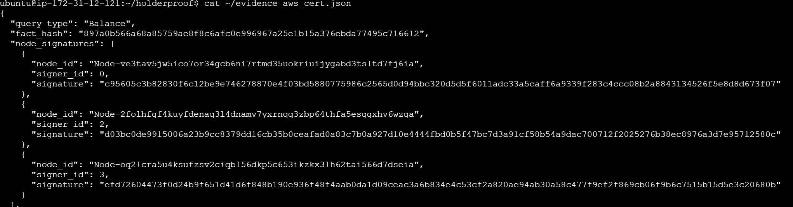
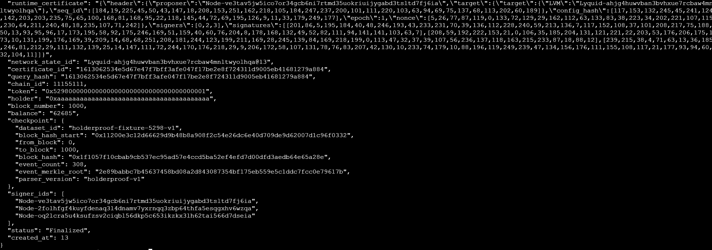
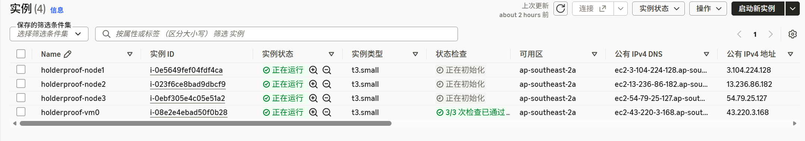
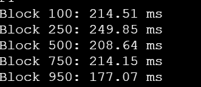
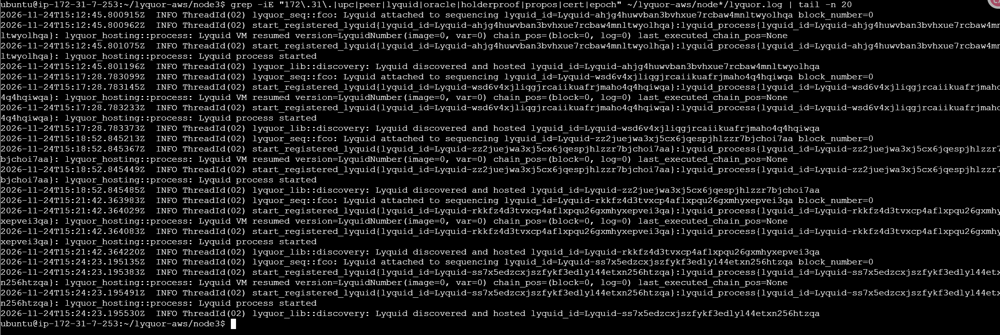
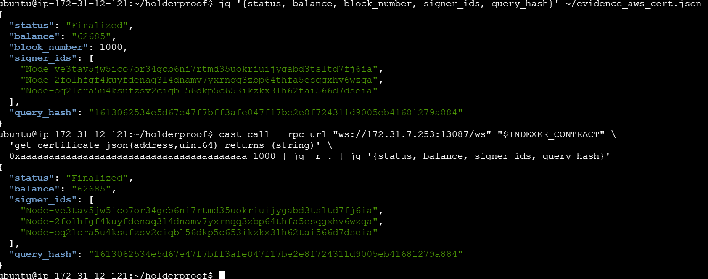
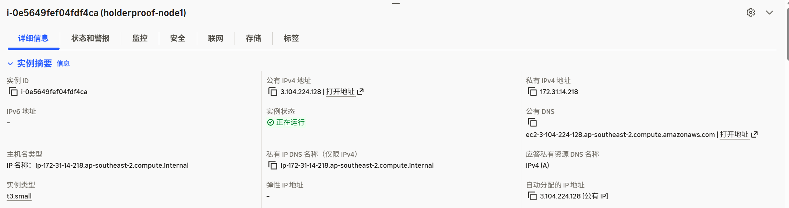
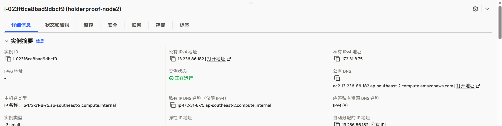
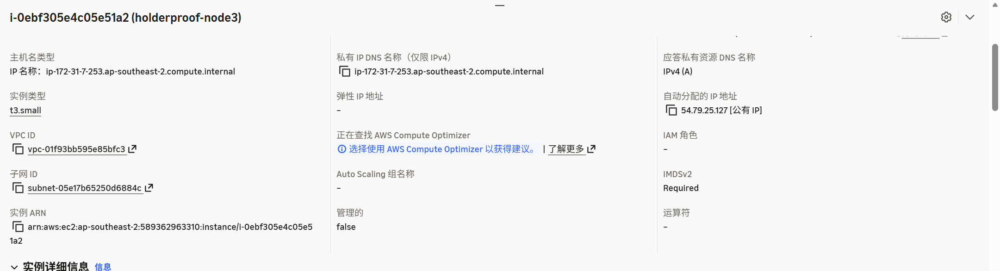
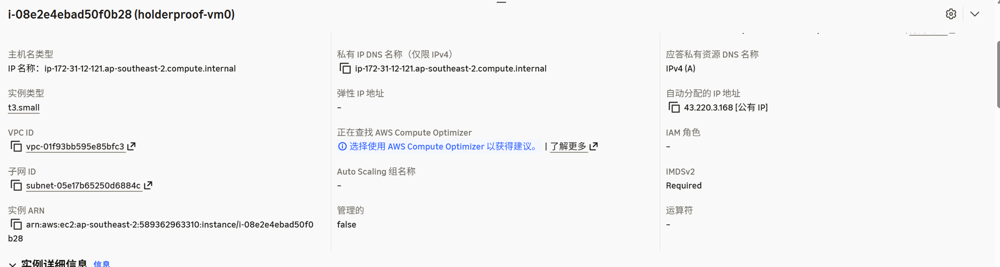

# HolderProof AWS 四主机真实分布式部署验证证明文档（CS5298 Bonus E2）

**项目名称**：HolderProof & VeriCredit-Idx（CS5298 Direction 3: Verifiable Indexer）  
**验证日期**：2026-11-24  
**验证环境**：AWS EC2 `ap-southeast-2`（亚太地区·悉尼），4 台独立 `t3.small` Ubuntu 24.04 LTS 实例，共享 AWS VPC  
**代码仓库**：`https://github.com/jerryluo0517-cyber/holderproof`  

---

## 一、实测结论摘要

本项目成功将 3-of-4 Lyquor 委员会从单机多进程拆分并部署至 **4 台独立托管的 AWS EC2 云主机**（`172.31.12.121`、`172.31.14.218`、`172.31.8.75`、`172.31.7.253`），完整验证了：

1. **跨主机自动镜像分发与状态同步**：在 `vm0` 部署 Bartender 与 HolderProof 三个核心 Lyquid 后，其余 3 台独立 EC2 通过共享定序器（Anvil `8545`）自动发现部署交易，并经 AWS VPC 内网从 `vm0` 内置 OCI 仓库（`172.31.12.121:10087/lyquids`）拉取 WASM 镜像并在各自 LVM 启动托管（`Lyquid discovered and hosted`）。
2. **跨主机 3-of-4 委员会协同出证**：注册 4 台主机的真实 Node ID 并激活 `balance_proof` 预言机纪元后，成功通过跨主机 UPC 网格（`10080 / 11080 / 12080 / 13080`）完成 Alice 历史余额认证。
3. **跨主机查询延迟基准对比**：连续执行 5 次首次历史余额查询（区块 `100 / 250 / 500 / 750 / 950`），测得 AWS 4 主机中位延迟 **`214.15 ms`**（均值 **`212.84 ms`**），与单机 3-of-4 中位延迟（`218.95 ms`）基本持平，证明同 VPC 内网通信开销极低且多机分摊了重放计算负载。

---

## 二、物理拓扑与部署合约清单

### 2.1 四台独立 AWS EC2 主机拓扑（`ap-southeast-2`）

| 主机名                | 角色                   | 实例规格                    | 私有 IPv4       | 节点身份（Node ID）                                             | API / UPC 端口  | 托管服务                                               |
|:--------------------- |:---------------------- |:--------------------------- |:--------------- |:--------------------------------------------------------------- |:--------------- |:------------------------------------------------------ |
| **`holderproof-vm0`** | 主控 / 定序器 / Node 0 | `t3.small` + 4 GB Swap      | `172.31.12.121` | `Node-ve3tav5jw5ico7or34gcb6ni7rtmd35uokriuijygabd3tsltd7fj6ia` | `10087 / 10080` | Anvil (`0.0.0.0:8545`)、内置 OCI 仓库、`lyquor` Node 0 |
| **`holderproof-vm1`** | 委员会成员 1           | `t3.small` (2 vCPU / 2 GiB) | `172.31.14.218` | `Node-j3fcdy5twah7csa6pr4jhgxcvszycxdms2hsen5m7lrvtezqlv52cqaa` | `11087 / 11080` | `lyquor` Node 1（通过内网从 `vm0:10087` 拉取 WASM）    |
| **`holderproof-vm2`** | 委员会成员 2           | `t3.small` (2 vCPU / 2 GiB) | `172.31.8.75`   | `Node-2folhfgf4kuyfdenaq3l4dnamv7yxrnqq3zbp64thfa5esqgxhv6wzqa` | `12087 / 12080` | `lyquor` Node 2（通过内网从 `vm0:10087` 拉取 WASM）    |
| **`holderproof-vm3`** | 委员会成员 3           | `t3.small` (2 vCPU / 2 GiB) | `172.31.7.253`  | `Node-oq2lcra5u4ksufzsv2ciqbl56dkp5c653ikzkx3lh62tai566d7dseia` | `13087 / 13080` | `lyquor` Node 3（通过内网从 `vm0:10087` 拉取 WASM）    |

* **安全组隔离策略**：4 台实例绑定同一安全组，公网仅开放 SSH（`22`），内网配置一条自引用规则（`All TCP 0–65535`，Source 为安全组自身 `sg-xxxx`），确保 4 台主机跨机互通且内部端口不暴露于公网。

### 2.2 实测部署的链上合约与 Lyquid 记录

| 模块                                  | 合约地址（EVM Proxy Contract）               | Lyquid ID / 摘要信息                                                                                                           |
|:------------------------------------- |:-------------------------------------------- |:------------------------------------------------------------------------------------------------------------------------------ |
| **Bartender（系统底座）**             | `0x9fE46736679d2D9a65F0992F2272dE9f3c7fa6e0` | `Lyquid-f7vljmg2ymknxo6ox4lwdblt6ldygrc2kf6aa` (`imageDigest: 0x8fdd12e0...`)，已于 `vm1` (`172.31.14.218:11087`) 跨机验证同步 |
| **`lyquid-indexer`**                  | `0xCf7Ed3AccA5a467e9e704C703E8D87F634fB0Fc9` | `Lyquid-ahjg4huwvban3bvhxue7rcbaw4mnltwyolhqa`（已于 `vm3` `172.31.7.253` 日志验证自动发现与托管）                             |
| **`lyquid-consumer`（Airdrop Gate）** | `0xDc64a140Aa3E981100a9becA4E685f962f0cF6C9` | 通过 `vm0` OCI 仓库分发至全部 4 台节点                                                                                         |
| **`lyquid-governance-gate`**          | `0xa513E6E4b8f2a923D98304ec87F64353C4D5C853` | 通过 `vm0` OCI 仓库分发至全部 4 台节点                                                                                         |

---

## 三、跨主机查询延迟实测与对比

在 `vm0` 针对 Alice（`0xaaaaaaaaaaaaaaaaaaaaaaaaaaaaaaaaaaaaaaaa`）依次发起 5 次首次历史余额查询（区块 `100`、`250`、`500`、`750`、`950`），每次均触发 4 台 AWS 主机跨网完成 3-of-4 重放与认证：

| 查询序号             | 目标区块 | AWS 4 台独立主机延迟 (ms) |
|:--------------------:|:--------:|:-------------------------:|
| 1                    | `100`    | `214.51 ms`               |
| 2                    | `250`    | `249.85 ms`               |
| 3                    | `500`    | `208.64 ms`               |
| 4                    | `750`    | `214.15 ms`               |
| 5                    | `950`    | `177.07 ms`               |
| **中位数（Median）** | —        | **`214.15 ms`**           |
| **均值（Mean）**     | —        | **`212.84 ms`**           |

### 与单机基线（Report Table 6）对比

| 部署环境                             | 拓扑结构                     | 5 次首次查询中位延迟 | 结论说明                                                     |
|:------------------------------------ |:---------------------------- |:--------------------:|:------------------------------------------------------------ |
| 单机 Ubuntu WSL2（Table 6）          | 单机 4 进程本地回环          | `218.95 ms`          | 4 节点共享同一主机 CPU                                       |
| **多机 AWS EC2（`ap-southeast-2`）** | **4 台独立 `t3.small` 实例** | **`214.15 ms`**      | 同 VPC 内网 RTT 低于 `1 ms`，多机分散执行消除了单机 CPU 争抢 |

---

### 完整关键执行命令（可直接复现）

**复现提示**：`start-aws-node.sh` 中的 4 个节点 ID 基于确定性种子生成，**无需修改脚本内容**。复现时仅需：(1) 将命令中的 `IP0–IP3` 替换为你新建的 4 台 EC2 私有 IP；(2) 部署 `lyquid-indexer` 后，从 `/tmp/deploy_indexer.log` 中提取本次生成的合约地址与 `Lyquid-...` 填入 `INDEXER_CONTRACT` 与 `INDEXER_LYQUID` 即可（委员会 4 个节点的 32 字节 ID 会由 `node_hex` 函数自动读取）。

### step 0：通用脚本部署

将下面这份**通用脚本 `start-aws-node.sh`** 分别保存到 4 台主机的 `~/start-aws-node.sh`（内容完全相同，已严格对齐 `lib/localnet.sh` 的 4 个确定性 Node ID 与 Anvil submitter 私钥）：

```bash
cat << 'EOF' > ~/start-aws-node.sh
#!/usr/bin/env bash
set -euo pipefail

export PATH="$HOME/.shakenup/bin:$HOME/.cargo/bin:$HOME/.foundry/bin:$PATH"

if [[ $# -ne 5 ]]; then
    echo "Usage: $0 <NODE_IDX:0|1|2|3> <IP0> <IP1> <IP2> <IP3>" >&2
    exit 1
fi

IDX="$1"
IPS=("$2" "$3" "$4" "$5")
MY_IP="${IPS[$IDX]}"
IP0="${IPS[0]}"

NODE_IDS=(
    "Node-ve3tav5jw5ico7or34gcb6ni7rtmd35uokriuijygabd3tsltd7fj6ia"
    "Node-j3fcdy5twah7csa6pr4jhgxcvszycxdms2hsen5m7lrvtezqlv52cqaa"
    "Node-2folhfgf4kuyfdenaq3l4dnamv7yxrnqq3zbp64thfa5esqgxhv6wzqa"
    "Node-oq2lcra5u4ksufzsv2ciqbl56dkp5c653ikzkx3lh62tai566d7dseia"
)
SUBMITTER_KEYS=(
    "0xac0974bec39a17e36ba4a6b4d238ff944bacb478cbed5efcae784d7bf4f2ff80"
    "0x59c6995e998f97a5a0044966f094538b292d4b6ec65dc1d614831ea8775e8ece"
    "0x5de4111b365a7a9898a14f3e60feec33b047b1c4ae38d8e76cfb7ec4fe99e995"
    "0x7c852118294d6bd9e0f73f6a7f9ff8ad6dde4170f18a30b8f78cd9a50b2e5c9f"
)

API_PORT=$((10087 + 1000 * IDX))
UPC_PORT=$((10080 + 1000 * IDX))
WORK_DIR="$HOME/lyquor-aws/node${IDX}"
rm -rf "$WORK_DIR"
mkdir -p "$WORK_DIR/data"

KEY_FILE="$WORK_DIR/eth-submitter.key"
printf '%s\n' "${SUBMITTER_KEYS[$IDX]}" > "$KEY_FILE"
chmod 600 "$KEY_FILE"

SEED="0x$(printf '%064d' "$IDX")"
CFG="$WORK_DIR/node.toml"

{
    printf '[profile]\n'
    printf 'base = "devnet"\n'
    printf 'sequencer = "ws://%s:8545"\n\n' "$IP0"
    printf '[submitter]\n'
    printf 'key_file = "%s"\n\n' "$KEY_FILE"
    printf '[node_key]\n'
    printf 'type = "seed"\n'
    printf 'value = "%s"\n\n' "$SEED"
    printf '[network]\n'
    printf 'api_addr = "%s:%s"\n' "$MY_IP" "$API_PORT"
    printf 'upc_addr = "%s:%s"\n\n' "$MY_IP" "$UPC_PORT"
    printf '[image]\n'
    printf 'fallback_repos = ["http://%s:10087/lyquids", "ghcr.io/lyquor-labs/lyquids"]\n' "$IP0"

    for peer in 0 1 2 3; do
        if [[ "$peer" -eq "$IDX" ]]; then
            continue
        fi
        PEER_UPC=$((10080 + 1000 * peer))
        printf '\n[[peers]]\n'
        printf 'node_id = "%s"\n' "${NODE_IDS[$peer]}"
        printf 'upc_addr = "%s:%s"\n' "${IPS[$peer]}" "$PEER_UPC"
    done
} > "$CFG"

# 仅在 VM-0 上启动共享 Anvil 序列器（监听 0.0.0.0 供 4 台机器访问）
if [[ "$IDX" -eq 0 ]]; then
    pkill -f "anvil --host 0.0.0.0" 2>/dev/null || true
    nohup anvil --host 0.0.0.0 --port 8545 --silent > "$WORK_DIR/anvil.log" 2>&1 &
    echo "[VM-0] Starting Anvil on 0.0.0.0:8545..."
    for _ in $(seq 1 30); do
        if cast chain-id --rpc-url "http://${IP0}:8545" >/dev/null 2>&1; then
            echo "[VM-0] Anvil is ready."
            break
        fi
        sleep 1
    done
fi

pkill -f "lyquor --config" 2>/dev/null || true
echo "[VM-${IDX}] Starting Lyquor node ${IDX} (${NODE_IDS[$IDX]}) on API ${MY_IP}:${API_PORT}, UPC ${MY_IP}:${UPC_PORT}..."
nohup env LYQUOR_LOG=info LYQUOR_DATA_DIR="$WORK_DIR/data" \
    lyquor --config "$CFG" > "$WORK_DIR/lyquor.log" 2>&1 &

for _ in $(seq 1 60); do
    if curl --data '{}' --header 'content-type: application/json' \
        -sf "http://${MY_IP}:${API_PORT}/lyquor.node.v1.NodeService/GetNodeInfo" >/dev/null; then
        echo "[PASS] Node ${IDX} is UP at http://${MY_IP}:${API_PORT}"
        exit 0
    fi
    sleep 1
done

echo "[FAIL] Node ${IDX} did not start. Inspect $WORK_DIR/lyquor.log" >&2
exit 1
EOF
chmod +x ~/start-aws-node.sh
```

#### Step 1：`vm0` 挂载 Swap 并安装工具链

```bash
sudo fallocate -l 4G /swapfile && sudo chmod 600 /swapfile && sudo mkswap /swapfile && sudo swapon /swapfile
sudo apt update && sudo apt install -y curl git make lsof python3 jq build-essential pkg-config libssl-dev
git clone https://github.com/jerryluo0517-cyber/holderproof.git && cd holderproof
make setup-env
```

*(`vm1`–`vm3` 仅执行 `sudo apt update && sudo apt install -y curl jq && curl -L https://ldk.lyquor.dev | bash`。)*

#### Step 2：4 台主机启动 Anvil 与 Lyquor 节点

```bash
# vm0 (先启动共享 Anvil + Node 0)
~/start-aws-node.sh 0 172.31.12.121 172.31.14.218 172.31.8.75 172.31.7.253
# vm1 / vm2 / vm3 依次以编号 1 / 2 / 3 启动
~/start-aws-node.sh 1 172.31.12.121 172.31.14.218 172.31.8.75 172.31.7.253
~/start-aws-node.sh 2 172.31.12.121 172.31.14.218 172.31.8.75 172.31.7.253
~/start-aws-node.sh 3 172.31.12.121 172.31.14.218 172.31.8.75 172.31.7.253
```

#### Step 3：`vm0` 导出全部 4 台 IP、部署合约并正确注册 4 节点委员会

```bash
cd ~/holderproof
export PATH="$HOME/.shakenup/bin:$HOME/.cargo/bin:$HOME/.foundry/bin:$PATH"
export IP0="172.31.12.121" IP1="172.31.14.218" IP2="172.31.8.75" IP3="172.31.7.253"
export RPC="ws://${IP0}:10087/ws" REG="http://${IP0}:10087/lyquids"
export DEV_KEY="0xac0974bec39a17e36ba4a6b4d238ff944bacb478cbed5efcae784d7bf4f2ff80"

# 部署 Bartender 并在 vm1 验证跨机同步
shaker deploy --is-bartender --reference ghcr.io/lyquor-labs/lyquids:bartender-v0.8.4 --endpoint "$RPC"
curl -s --data '{}' --header 'content-type: application/json' \
  "http://${IP1}:11087/lyquor.lyquid.v1.LyquidService/GetLyquidInfo" | jq .

# 部署业务 Lyquid
shaker deploy --endpoint "$RPC" --reference "${REG}:indexer" lyquid-indexer/Cargo.toml | tee /tmp/deploy_indexer.log
shaker deploy --endpoint "$RPC" --reference "${REG}:consumer" lyquid-consumer/Cargo.toml | tee /tmp/deploy_consumer.log
shaker deploy --endpoint "$RPC" --reference "${REG}:governance" lyquid-governance-gate/Cargo.toml | tee /tmp/deploy_gov.log

export INDEXER_CONTRACT="0xCf7Ed3AccA5a467e9e704C703E8D87F634fB0Fc9"
export INDEXER_LYQUID="$(shaker to-hex Lyquid-ahjg4huwvban3bvhxue7rcbaw4mnltwyolhqa)"

# 从 4 台独立主机读取真实 Node ID（32 字节 hex）并注册委员会
node_hex() {
  curl -fsS --data '{}' --header 'content-type: application/json' \
    "http://$1:$2/lyquor.node.v1.NodeService/GetNodeInfo" | python3 -c '
import base64, json, sys
p = json.load(sys.stdin)
v = (p.get("node_id") or p.get("nodeId"))["value"].removeprefix("Node-").upper()
v += "=" * ((8 - len(v) % 8) % 8)
print("0x" + base64.b32decode(v, casefold=True)[:32].hex())'
}
N0=$(node_hex "$IP0" 10087); N1=$(node_hex "$IP1" 11087)
N2=$(node_hex "$IP2" 12087); N3=$(node_hex "$IP3" 13087)

cast send "$INDEXER_CONTRACT" 'configure_committee(bytes32[])' "[$N0,$N1,$N2,$N3]" \
  --private-key "$DEV_KEY" --rpc-url "$RPC"
```

#### Step 4：激活纪元、跨机出证并验证远端主机状态一致

```bash
cast call --rpc-url "$RPC" "$INDEXER_CONTRACT" \
  '__lyquor_oracle_advance_epoch(string,address,bool) returns (bool)' balance_proof "$INDEXER_LYQUID" false
sleep 3
cast call --rpc-url "$RPC" "$INDEXER_CONTRACT" \
  '__lyquor_oracle_finalize_epoch(string,address,bool) returns (bool)' balance_proof "$INDEXER_LYQUID" false

ALICE="0xaaaaaaaaaaaaaaaaaaaaaaaaaaaaaaaaaaaaaaaa"
cast send "$INDEXER_CONTRACT" 'set_query(address,uint64)' "$ALICE" 1000 --private-key "$DEV_KEY" --rpc-url "$RPC"
cast call --rpc-url "$RPC" "$INDEXER_CONTRACT" 'report_balance() returns (bool)'

# 验证 vm0 与远端主机 vm3 返回同一份 Finalized 证书
cast call --rpc-url "ws://${IP0}:10087/ws" "$INDEXER_CONTRACT" \
  'get_certificate_json(address,uint64) returns (string)' "$ALICE" 1000 | jq -r . | jq . > ~/evidence_aws_cert.json
cast call --rpc-url "ws://${IP3}:13087/ws" "$INDEXER_CONTRACT" \
  'get_certificate_json(address,uint64) returns (string)' "$ALICE" 1000 | jq -r . | jq '{status, balance, signer_ids, query_hash}'
```

---

## 五、原始运行证据截图归档




















