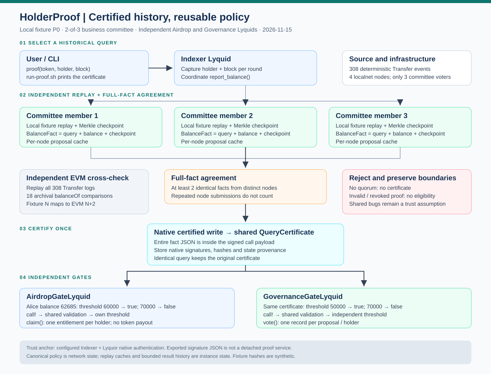

# HolderProof 当前进度

更新日期：2026-11-15。当前完成到执行方案 03/04 的本地 fixture P0。
内部历史 Step 编号不是执行方案章节号。最新提交及远端同步状态以 Git 记录为准。



## 1. 已完成的闭环

查询一个 Token、holder 和历史区块，三个委员会成员独立重放完整事实，
达到 2-of-3 一致后执行原生认证并持久化证书。空投、治理两个独立 Lyquid
读取同一份当前 Finalized 证书，按各自门槛判断资格。

官方 localnet 启动四个基础设施节点，只有前三个是业务委员会成员。
第四个节点不改变应用的 2-of-3 规则。

## 2. 当前实现与证据

| 内容 | 状态 |
|---|---|
| 308 条确定性 Transfer、Python 标准答案 | 已完成 |
| checked U256 历史余额重放、Merkle 根 | 已完成 |
| 完整查询、余额、checkpoint 一起达成共识并进入签名载荷 | 已完成 |
| 原生证书、签名字节、节点映射、来源引用 | 已保存并校验一致性 |
| 相同查询幂等、当前状态撤销检查 | 已实现 |
| 独立空投和治理消费者 | 已实现并部署验收 |
| 两个消费者的正反资格结果 | 已验收 |
| 节点提案缓存、消费者实例历史 | 已实现 |
| 查询 CLI、一键验收 | 已完成 |
| 历史 EVM `balanceOf` 对照 | 308 条日志、18 次读取一致 |

## 3. 已验证的演示结果

Alice 在 fixture 区块 1000 的余额为 **62685**。

| 消费者 | 门槛 | 资格结果 |
|---|---|---|
| AirdropGateLyquid | 60000 | true |
| AirdropGateLyquid | 70000 | false |
| GovernanceGateLyquid | 50000 | true |
| GovernanceGateLyquid | 70000 | false |

四个结果复用同一证书，门槛变化不重写余额事实。
资格检查、重复查询和实例历史已在实际本地网络中通过。
`claim()` 与 `vote()` 已有身份绑定及防重复记录，但完整支付或 DAO 执行不在当前验收范围。

## 4. 验证数量与运行入口

| 检查 | 结果 |
|---|---|
| Rust workspace 编译 | 五个 crate 通过 |
| Indexer guest 测试 | 12 项通过 |
| 共享 Gate guest 测试 | 12 项通过 |
| Python 标准答案测试 | 6 项通过 |
| fixture 校验 | 9 项通过 |
| EVM Transfer 与历史余额 | 308 条日志、18 次查询通过 |

```bash
make acceptance
./scripts/stop-step4.sh
```

证据保存于 `.run/step4/` 和 `.run/acceptance/`，运行缓存不提交。
完整逐项验收与实现适配见 [03/04 验收记录](../reports/PLAN_03_04_ACCEPTANCE.md)。

## 5. 本轮文档与可读性更新

架构 Markdown、Mermaid、SVG/PNG、代码导读和协作指南统一为当前架构，
HTML/PDF 从对应 Markdown 生成。Indexer 的证书装配拆到独立模块，
查询 CLI 主函数只负责流程编排，聚合变量使用明确业务命名。

原始执行方案、早期操作记录和 2026-11-12 PDF 是历史资料；不把它们当成当前验收说明。

## 6. 实现适配及剩余工作

原子跨 Lyquid `call!` 在 LDK 0.8.4 中只能从 Network 方法执行，
因此权威策略和动作记录保留在共享状态，实例状态用于本地缓存与历史。

数据源仍是本地 fixture，哈希是合成值。历史 EVM 对照使用独立测试合约，
fixture 区块 N 对应 EVM N+2；对照验证余额，不验证 Sepolia 链头或真实最终性。
消费者依赖配置的 Indexer 和运行时认证，不提供独立的脱机签名验证注册表。

后续范围：P1 的 MIN_BALANCE、ACTIVE_RATIO、窗口证书；Sepolia 接入；
完整 E3 故障注入和外部用户测试；UI、最终报告、幻灯片及录制演示。
已有 TWAB 重放不代表全部 P1 已完成。
