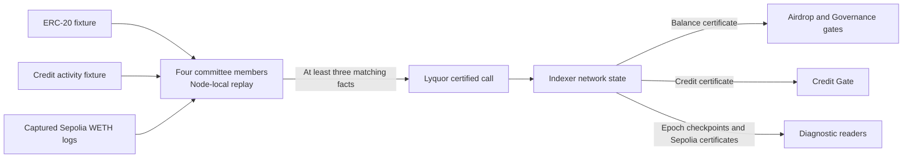

# HolderProof and VeriCredit-Idx

**CS5298 Final Project Report · 23 November 2026**

Direction 3 · Verifiable Indexer

[HolderProof repository](https://github.com/jerryluo0517-cyber/holderproof) · [Current source (`main`)](https://github.com/jerryluo0517-cyber/holderproof/tree/main)

## Abstract

HolderProof makes a historical token balance available as a certificate that multiple applications can act on. Four Lyquor committee members replay an ordered event history. At least three must agree on the complete query result and its checkpoint before the Indexer records a certified fact. Airdrop and Governance apply separate policies to the same balance certificate. VeriCredit-Idx uses the same certification mechanism for credit activity and supplies the Credit Gate with a separate credit certificate. Acceptance on a local devnet reconciled 308 EVM Transfer logs and 18 historical balance reads, verified four epoch checkpoints and four credit quotes, and certified a balance derived from a captured window of 169 Sepolia WETH events. Three external participants completed the trial without assistance. One used the terminal on Windows WSL2 and two used the Web console on macOS.

A subsequent compatibility check documented the Windows launcher on a prepared WSL2 Ubuntu environment.

## 1. Problem Analysis

Airdrop operators and governance developers can both use token balances at an agreed snapshot block. Their applications must identify the same chain, token, holder and block before applying their own policies. In the HolderProof fixture, an airdrop requires 60,000 units at block 1,000 and a governance proposal requires 70,000. Alice holds 62,685 units at that block and qualifies for the airdrop. The governance policy gives a different answer for the same account and certified balance.

An archival RPC endpoint can answer a historical `balanceOf` call. The caller depends on the endpoint for that answer. A GraphQL subgraph serves structured entities derived from indexed events. Its query interface gives applications a way to retrieve processed data. HolderProof addresses the next step in the eligibility workflow by persisting an issuer-bound fact that another Lyquid can read and check during a state transition. Airdrop and Governance can then use the same certified output while maintaining their own eligibility rules and records. [Ethereum JSON-RPC](https://ethereum.org/developers/docs/apis/json-rpc/) · [ERC-20](https://eips.ethereum.org/EIPS/eip-20) · [The Graph subgraphs](https://thegraph.com/docs/en/subgraphs/overview/)

The distinction matters when the balance authorizes an action. An application must connect the returned amount to the specific request and source before it records a claim or vote. In HolderProof, the query hash identifies the request, the checkpoint identifies the history used for the calculation, and the configured Indexer and attached oracle evidence establish provenance for the receiving application. [Certificate rules](../operations/step4-certificate.md)

## 2. Original Contribution

The project implements deterministic transfer replay, an issuer-bound certificate schema and a shared validation core. Its central design choice is to certify a complete fact, including the query, balance and input checkpoint, and let each consumer apply its own policy. The same fixture balance certificate serves the two eligibility gates. Each gate owns its configuration and action records, so a threshold change can occur without redefining the historical fact.

The Indexer publishes periodic checkpoints for aggregate history and issues holder certificates on demand. A checkpoint commits to the event prefix through an epoch boundary. An individual certificate fixes the query and replay result for a requested holder. This layout provides a shared record of aggregate history without writing one certificate for every holder at every epoch.

VeriCredit-Idx extends the workflow to activity in a block window. Its replay discounts matched short-window reversals between the same counterparties, then uses clean volume, repayment counts and liquidation counts to compute a score. The Credit Gate maps that certified score to fee and loan-to-value (LTV) terms. The credit certificate binds the scoring parameters alongside the input window, so a different wash window produces a different query.

Lyquor LDK supplies two-phase oracle calls, authenticated certified execution, shared network state and synchronous cross-Lyquid calls. The project supplies the replay, fact and checkpoint schemas, proposal agreement rule, application validation, policy mapping and test fixtures. [Lyquor certified calls](https://docs.lyquor.dev/docs/ldk/oracle/) · [Indexer implementation](../../lyquid-indexer/src/lib.rs) · [Gate core](../../holderproof-gate-core/src/lib.rs)

## 3. Technical Design

### 3.1 Data path and state



Four processes on one local devnet host serve as committee members. Each process replays its own copy of the relevant fixture and uses instance state for node-local proposal data. The Indexer writes certified facts to network state. The downstream applications read the shared records through Lyquor and maintain their own policy state. The CLI and Web console submit queries and expose the resulting diagnostics. [Indexer state and oracle methods](../../lyquid-indexer/src/lib.rs) · [Web guide](../guides/WEB_GUIDE.md)

On Windows, the PowerShell launcher starts and monitors the Ubuntu runtime. Anvil, the four Lyquor nodes and the Web server run inside WSL2. The Windows browser connects to the local Web console. [Launcher](../../scripts/windows/holderproof.ps1) · [WSL2 runtime](../../scripts/windows/runtime.sh)

| Oracle topic | Certified result |
|---|---|
| `balance_proof` | Fixture balance through a specified snapshot block. |
| `credit_proof` | Activity metrics and score for a user, block window and parameter set. |
| `checkpoint_proof` | Event count, cumulative volume, holder count and Merkle root through an epoch boundary. |
| `sepolia_proof` | Holder balance derived from the captured Sepolia WETH window. |

### 3.2 Certification and provenance

A balance query includes the chain, token, holder, block and parser version. Its canonical digest provides the query hash and certificate ID. Members independently compute the balance and create a checkpoint containing the dataset identifier, block range, boundary hashes, event count, event Merkle root and parser version. The Indexer groups identical full facts and excludes duplicate proposals from a member. A certified call carries the agreed fact to the Indexer, which records the result with the native oracle certificate and signer evidence. A repeated query can return the original certificate under the same key. [Shared data types](../../holderproof-types/src/lib.rs) · [Certificate rules](../operations/step4-certificate.md)

For two three-member quorums in a four-member committee, the overlap contains at least two members. With at most one Byzantine member, that intersection contains an honest member. If honest members approve at most one fact for the same oracle instance and Lyquor enforces the certified-call rules, that member prevents conflicting facts from both obtaining quorum. Progress requires three available members that agree on the full fact. Shared input errors can still lead all four to agree on the same wrong answer. [Lyquor certified calls](https://docs.lyquor.dev/docs/ldk/oracle/) · [Practical Byzantine Fault Tolerance](https://pdos.lcs.mit.edu/6.824/papers/castro-practicalbft.pdf)

### 3.3 Gate policies

The Airdrop and Governance gates use `call!` to retrieve the current certificate from their configured Indexer. Shared validation recomputes the query and fact digests, checks the checkpoint and `Finalized` status, and compares the attached signer details with the native oracle evidence. It also checks the target Lyquid, sequence backend and state reference against the expected issuer. Each gate compares the certified balance with its own threshold. A qualifying holder can claim once and vote once per proposal. The gates bind those actions to the caller and recheck the certificate when recording an action. [Shared gate validation](../../holderproof-gate-core/src/certificate.rs) · [Issuer binding](../../holderproof-gate-core/src/lib.rs)

The Credit Gate checks the certificate for the requested user and the configured block window. With the Indexer configured, `quote_or_fallback` applies Base terms when the certificate is unavailable, invalid or stale. [Credit Gate implementation](../../lyquid-credit-gate/src/lib.rs)

| Tier | Score | Fee | LTV |
|---|---:|---:|---:|
| VIP | 800–1,000 | 5 bps | 85% |
| Standard | 500–799 | 15 bps | 75% |
| Base | 0–499 | 30 bps | 60% |

## 4. Implementation

The Rust workspace uses Lyquor LDK 0.8.4. The `holderproof-types` crate defines the shared wire formats. The `lyquid-indexer` crate handles replay, proposal agreement and certificate storage. The `holderproof-gate-core` crate validates certificates and supplies shared policy logic. Airdrop, Governance and Credit run as separate Lyquids in `lyquid-consumer`, `lyquid-governance-gate` and `lyquid-credit-gate`, respectively. [Workspace manifest](../../Cargo.toml) · [Shared types](../../holderproof-types/src/lib.rs)

**Fixture replay.** The parser validates source metadata and rejects duplicate event positions before replay. The Indexer uses checked integer updates and treats self-transfers as balance-neutral. It hashes the replay prefix into a Merkle root and includes that root in the checkpoint. The fixture uses synthetic block hashes. For the independent EVM comparison, a test token on Anvil executes the corresponding transfers, and the verifier maps fixture blocks to EVM heights for historical `balanceOf` reads. [Fixture replay](../../lyquid-indexer/src/fixture.rs) · [Historical EVM verifier](../../scripts/verify_historical_balance.py)

```text
balance = 0
for transfer in validated order by (block_number, log_index):
    if transfer.block_number > snapshot_block: stop
    if transfer.from == holder and transfer.to != holder:
        balance = checked_subtract(balance, transfer.amount)
    if transfer.to == holder and transfer.from != holder:
        balance = checked_add(balance, transfer.amount)
certify balance together with the checkpoint for the event prefix
```

**Credit scoring.** The 40-event fixture contains swaps, repayments and liquidations. For one user, replay matches opposite-direction swaps with the same counterparty within the wash window. It matches the smaller remaining amount and sums the unmatched volume as clean volume. With clean volume `V`, repayment count `R` and liquidation count `L`, the implementation uses the following integer formula. The defaults are `w1 = 35`, `w2 = 20`, `alpha = 2` and a three-block wash window. [Credit replay](../../lyquid-indexer/src/credit.rs) · [Reference fixture](../../fixtures/credit_expected.json)

```text
score = min(1000, (w1 * floor(log2(1 + V)) + w2 * R) // (1 + alpha * L))
```

**Epoch checkpoints.** The verifier requests snapshots at blocks 250, 500, 750 and 1,000. Every member computes the cumulative fact over the prefix ending at the target block. The certified update stores a checkpoint keyed by that boundary. [Epoch verifier](../../scripts/verify_epoch_checkpoints.py)

**Sepolia WETH.** The fetch script pages through WETH `Transfer` logs and records the boundary block hashes. The stored snapshot contains 169 normalized events from block 12,184,050 through 12,184,649. The replay starts at zero over the captured window and yields 0.002 WETH for the example holder. The certificate therefore represents the result of that window replay. [Fetch script](../../scripts/fetch_sepolia_logs.py) · [Snapshot metadata](../../fixtures/sepolia_expected.json) · [Sepolia replay](../../lyquid-indexer/src/sepolia.rs)

## 5. Evaluation and Results

### 5.1 Team 3-of-4 acceptance and self-audit

The team ran acceptance on a fresh four-node local devnet at `77d5d66`. The current `scripts/run-3of4-acceptance.sh` entry point records the revision and environment, runs E3, epoch, credit and Sepolia checks, and saves logs and JSON in `.run/acceptance/`. The tests cover the Python reference, EVM history, live cross-Lyquid consumption and quorum recovery. [Team acceptance record](PLAN_06_MEMBER_EVALUATION.md) · [Acceptance script](../../scripts/run-3of4-acceptance.sh) · [Reproduction guide](../guides/TESTING.md)

| Check | Observed result |
|---|---|
| Fixture and unit checks | 9 fixture checks, 6 Python tests and 36 Rust guest tests passed. The Rust guest tests comprised 21 Indexer and 15 Gate Core tests. |
| Balance and reuse | Alice held 62,685 at block 1,000. The finalized certificate had three signers and retained its identity after resubmission. Both gates read the same query hash. |
| EVM reconciliation | All 308 Transfer logs and 18 historical `balanceOf` reads matched the Python reference. |
| Gate actions | Claim and vote checks covered qualification, caller binding and duplicate rejection. Only the initializer revoked the certificate. The revoked state blocked both actions. |
| Quorum recovery | With one member paused, the remaining three certified a new query. With two paused, no certificate appeared during the observation window. Certification resumed after recovery. |
| Epoch checkpoints | Blocks 250, 500, 750 and 1,000 recorded 89, 172, 255 and 308 events respectively. Each checkpoint had three signers. |
| Sepolia snapshot | The certificate for block 12,184,649 had three signers. It covered 169 WETH Transfer events and recorded a 0.002 WETH window replay for the sample holder. |

The earlier E3 self-audit at the 2-of-3 baseline documents adversarial cases such as altered checkpoint fields, repeated member proposals and insufficient signers. The 3-of-4 availability observations above refer to the later team run. [E3 self-audit record](PLAN_05_E3_AUDIT.md)

### 5.2 Credit quotes

| Sample | Score | Tier | Fee | LTV |
|---|---:|---|---:|---:|
| Alice | 940 | VIP | 5 bps | 85% |
| Dave | 675 | Standard | 15 bps | 75% |
| Bob | 495 | Base | 30 bps | 60% |
| Carol | 250 | Base | 30 bps | 60% |

The default matcher removed 2,000,000 units of reversal volume from Bob’s activity, leaving 15,000 units of clean volume. Setting the wash window to zero raised Bob’s score from 495 to 740. The quote moved from Base to Standard, with the fee falling from 30 to 15 bps. This parameter test shows how the configured matching rule affects the fixture quote. [Team credit results](PLAN_06_MEMBER_EVALUATION.md) · [Expected credit metrics](../../fixtures/credit_expected.json)

### 5.3 Local web console

The recorded Web checks returned Alice’s fixture balances of 50,000, 57,685 and 62,685 at blocks 0, 950 and 1,000 respectively. The two qualification cards showed `Not evaluated` at blocks 0 and 950. At block 1,000, the airdrop reported eligible and governance reported ineligible. The request handler rejects fractional or out-of-range blocks. The evidence view displayed the imported block 950 certificate’s block, balance and signers. The separate browser download check in the `2552c5e` record timed out. [Balance references](../../fixtures/expected_results.json) · [Web guide](../guides/WEB_GUIDE.md) · [Request handler](../../scripts/serve_web.py) · [Archived Web checks](external-tests/EXTERNAL_USER_02_MACOS.md#功能与补充检查)

The Windows compatibility record at `878842d` covers a prepared WSL2 Ubuntu environment. It reports successful startup from a path containing spaces, status, repeated startup checks, stop and restart. A Windows HTTP request confirmed the Alice block 1,000 result. The launcher's `test` action passed 9 fixture checks, 6 Python tests, workspace compilation and 36 Rust guest tests. [WSL2 verification notes](../guides/WINDOWS_WSL.md#3-验证网页) · [`878842d`](https://github.com/jerryluo0517-cyber/holderproof/commit/878842da7ef8e666de3ee667f8e6fe582cf802b9)

### 5.4 Query latency

Each run measured five sequential first-time queries after starting a local network. Both medians include query confirmation and certification. The 3-of-4 run explicitly checked that each certificate was absent before querying and included local CLI overhead. Quorum size varied alongside the code revision and environment, so attributing the difference to quorum size would require a controlled comparison. [2-of-3 benchmark](PLAN_06_MEMBER_EVALUATION.md) · [3-of-4 benchmark](external-tests/EXTERNAL_USER_02_MACOS.md#五次首次查询计时)

| Committee | Revision | Queries | Median |
|---|---|---:|---:|
| 2-of-3 | `db1532f` | 5 | 58.10 ms |
| 3-of-4 | `2552c5e` | 5 | 218.95 ms |

### 5.5 External user testing

The external task asks a participant to retrieve a balance certificate and verify airdrop and governance eligibility. Three external participants completed the task without assistance, meeting the target of three completions. The feedback form records the test revision, elapsed trial time, assistance and results. [Trial task sheet](../guides/EXTERNAL_USER_TEST.md)

| Participant | Setup | Result |
|---|---|---|
| E01 | Windows WSL2, terminal | Completed without assistance in 45.9 s at `fdd2a0e`. Alice at block 1,000 held 62,685. Airdrop reported eligible and governance reported ineligible. |
| E02 | macOS, Web | Completed without assistance in 67.5 s at `46ef730`. Bob at block 1,000 held 51,886. Both gates reported ineligible. |
| E03 | macOS, Web | Completed without assistance in 358.4 s at `cd15cec`. Alice at block 1,000 held 62,685. Airdrop reported eligible and governance reported ineligible. |

Each completed trial produced a `Finalized` certificate with three distinct signers. Both gates in each run referenced the certificate’s query hash. The durations include environment checking, demo startup and result confirmation. They measure participant workflows and use a different interval from the query benchmark. E03’s earlier terminal attempt ended before demo startup and remains part of the E03 record. [E01 archive](external-tests/EXTERNAL_USER_01_WINDOWS.md) · [E02 Web archive](external-tests/EXTERNAL_USER_02_MACOS.md#web-试用) · [E03 archive](external-tests/EXTERNAL_USER_03_MACOS.md)

The Windows trial used the terminal recorder in WSL2 and captured the certificate and both eligibility results. E02’s request to test Bob prompted the addition of `--holder` to the Web recorder, which checks eligibility against the selected holder’s reference balance and records the holder in the feedback form. [Windows trial instructions](../guides/EXTERNAL_USER_TEST.md#windows-外部试用) · [Web trial recorder](../../scripts/record_external_test.py)

## 6. Limitations and Reflection

**Input coverage.** The event Merkle root commits to the history the members replayed. Coverage depends on how the source logs were collected and on the finality of their blocks. A partial window needs an opening balance to reconstruct absolute state. A follow-up Sepolia check could compare the same finalized range from independently configured RPC sources and reconcile opening and closing archival balances against the replay.

**Committee deployment.** Four local processes exercise agreement and controlled process failure. This setup shares a host and a replay implementation, so it leaves independent-host deployment, common-mode errors and network partitions open. The measured timing reflects a same-machine local devnet.

**Credit calibration.** The synthetic cases test the behavior of the fixed-window matching rule and the score mapping. They provide no basis for calibrating lending risk against real outcomes. Representative account histories and a separate calibration study would be needed before using the quotes for lending decisions.

**Reproduction.** The external trials cover the terminal workflow on Windows WSL2 and the Web workflow on macOS. The launcher compatibility check covered an already provisioned WSL2 Ubuntu installation. A clean Windows installation remains to be evaluated. [Environment requirements](../guides/TESTING.md) · [Windows startup guide](../guides/WINDOWS_WSL.md)

## 7. Contributions and Attribution

| Contributor | Git-evidenced contribution |
|---|---|
| `jerryluo0517-cyber` | Balance certification, common gate checks, dual-gate integration, historical EVM comparison, Web console and external-trial tooling. [`154939c`](https://github.com/jerryluo0517-cyber/holderproof/commit/154939c) · [`b87c980`](https://github.com/jerryluo0517-cyber/holderproof/commit/b87c980) · [`46ef730`](https://github.com/jerryluo0517-cyber/holderproof/commit/46ef730) |
| `hwzhang0317` | Credit replay and Gate, checkpoint and Sepolia paths, related fixtures and the dispersion check. [`5f3a904`](https://github.com/jerryluo0517-cyber/holderproof/commit/5f3a904) · [`d55a449`](https://github.com/jerryluo0517-cyber/holderproof/commit/d55a449) |
| `Hitori-Chan` | Windows PowerShell launcher, WSL2 Ubuntu runtime script and Windows startup guide. [`878842d`](https://github.com/jerryluo0517-cyber/holderproof/commit/878842da7ef8e666de3ee667f8e6fe582cf802b9) |

The implementation relies on Lyquor LDK for execution and certified calls, and on Foundry Anvil for the local EVM comparison. The repository contains the synthetic fixtures and captured Sepolia snapshot used in evaluation. [Lyquor LDK](https://docs.lyquor.dev/docs/ldk/build-deploy-test/) · [Anvil](https://www.getfoundry.sh/anvil/index.html)

## 8. AI Use Statement

OpenAI Codex assisted with reviewing and refactoring certificate validation, building test and documentation tools, running automated checks, and drafting and editing this report. A team member supplied the acceptance run, and the external participants submitted their trial results and assistance status. The report’s claims were checked against Rust source, Python fixture outputs, saved logs and archived participant forms. The archived `2552c5e` technical run is recorded separately from the three completed external trials. [Team evidence](PLAN_06_MEMBER_EVALUATION.md) · [External and technical evidence](external-tests/EXTERNAL_USER_02_MACOS.md)

## 9. Conclusion

HolderProof certified a historical balance once and let two independently deployed policy gates act on that fact. The local evaluation checked agreement with historical EVM reads, certificate reuse, application actions and quorum recovery. VeriCredit-Idx applied the same oracle model to credit quotes, alongside separate checkpoint and Sepolia paths. Three external participants completed the trial across the Windows WSL2 terminal and macOS Web workflows.

## References

- Ethereum Improvement Proposals. [ERC-20 Token Standard](https://eips.ethereum.org/EIPS/eip-20).
- Ethereum. [JSON-RPC API](https://ethereum.org/developers/docs/apis/json-rpc/).
- Ethereum Execution APIs. [`eth_getLogs`](https://ethereum.github.io/execution-apis/api/methods/eth_getLogs/).
- The Graph. [Subgraphs Overview](https://thegraph.com/docs/en/subgraphs/overview/).
- Lyquor. [Oracle and certified calls](https://docs.lyquor.dev/docs/ldk/oracle/) and [Build, deploy and test](https://docs.lyquor.dev/docs/ldk/build-deploy-test/).
- Miguel Castro and Barbara Liskov. [Practical Byzantine Fault Tolerance](https://pdos.lcs.mit.edu/6.824/papers/castro-practicalbft.pdf). OSDI, 1999.
- Foundry. [Anvil documentation](https://www.getfoundry.sh/anvil/index.html).
- HolderProof project. [Source, test scripts and archived evidence](https://github.com/jerryluo0517-cyber/holderproof).
