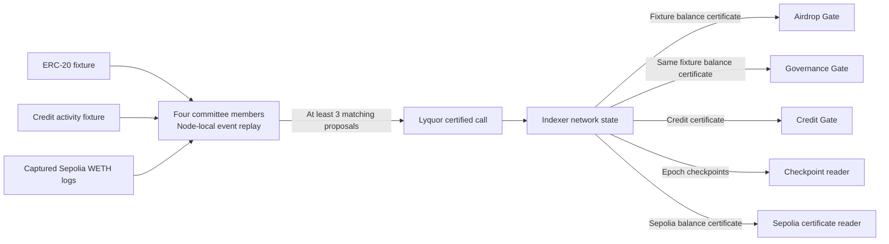

# HolderProof and VeriCredit-Idx

**CS5298 Final Project Report · First draft · 22 November 2026**

This report describes the three-of-four committee design introduced in commit `c11e69c`. The project repository contains the source code and reproduction instructions. [HolderProof repository](https://github.com/jerryluo0517-cyber/holderproof) · [Design baseline](https://github.com/jerryluo0517-cyber/holderproof/tree/c11e69c)

## Abstract

HolderProof certifies historical token balances so applications can use the same result to make different decisions. Four committee members replay the same ordered events. Lyquor certifies the result once at least three members agree on the complete fact. The Airdrop and Governance gates use one balance certificate to apply their own eligibility thresholds. VeriCredit-Idx uses the same certification process to turn activity within a block window into fee and loan-to-value quotes. In the three-of-four evaluation, 308 Transfer logs and 18 historical EVM balance reads matched the fixture. The run also verified both gates, four epoch checkpoints, four credit quotes and a certificate for a captured Sepolia WETH event window.

## 1. Problem Analysis

An airdrop and a governance proposal can both use a holder’s token balance at a snapshot block. Each application needs the answer for the same token, account and position in the chain’s history. An archival RPC endpoint can return contract state at that block. A shared indexer can serve both applications, provided that each can identify the input history, verify the issuer and check the certificate when it acts. [Ethereum JSON-RPC](https://ethereum.org/developers/docs/apis/json-rpc/)

HolderProof addresses two requirements. Committee members need a reproducible way to derive the same result from the same history. Applications then need to reuse that result while retaining control over their own thresholds, actions and records. A certificate links the answer to the original query and the checkpoint for the input data.

The ERC-20 standard defines the `Transfer` event and the `balanceOf` interface. For the fixture token, a member can reconstruct an account’s balance by processing transfers through the requested block. Historical `balanceOf` reads on an EVM ledger provide an independent way to check that calculation. [ERC-20 standard](https://eips.ethereum.org/EIPS/eip-20)

## 2. Original Contribution

HolderProof combines deterministic event replay with a certificate that independently deployed Lyquids can read in the same call that checks eligibility. The Indexer certifies the query, balance and checkpoint together. The Airdrop and Governance gates use shared validation code and store their own policies and action records. A certified balance of 62,685 meets the example airdrop threshold of 60,000 and falls below the governance threshold of 70,000.

VeriCredit-Idx extends the design to activity within a block window. Its query includes the user, window and scoring parameters. The Credit Gate uses the certified score to return a fee and a loan-to-value (LTV) quote. A separate oracle topic certifies checkpoint summaries at selected blocks, allowing readers to compare event counts and commitments over time.

The project implements the replay, fact schemas, state layout and gate policies. Lyquor provides certified calls, and the design draws on established Merkle commitments, ERC-20 event semantics and Byzantine quorum arithmetic. [Lyquor certified calls](https://docs.lyquor.dev/docs/ldk/oracle/) · [Castro and Liskov, Practical Byzantine Fault Tolerance](https://pdos.lcs.mit.edu/6.824/papers/castro-practicalbft.pdf)

## 3. Technical Design

### 3.1 Data path and state

Each member replays events locally. The Indexer stores certificates and epoch checkpoints in shared network state. Each gate stores its configuration and action or quote records. The CLI and local web console accept fixture blocks from 0 to 1000. For a query at block 1000, the web console also requests eligibility decisions from both gates, whose policies use that snapshot. The console can export the complete balance certificate as JSON. The separate evidence view displays saved certificates, checkpoint and audit records, and browser simulations. [Web user guide](../guides/WEB_GUIDE.md)

| Oracle topic | Certified result |
|---|---|
| `balance_proof` | A holder’s balance through the requested fixture block. |
| `credit_proof` | A user’s activity metrics and credit score for the requested window and parameters. |
| `checkpoint_proof` | The event count, cumulative volume, holder count and Merkle root through an epoch boundary. |
| `sepolia_proof` | A holder’s replay result for the captured Sepolia WETH event window. |

### 3.2 Certification and provenance

Each committee member proposes a complete fact. For a balance query, that fact contains the canonical query, computed balance and checkpoint. The checkpoint records the dataset, block range, boundary hashes, parser version, event count and Merkle root. The Indexer excludes members who submit multiple proposals and requires identical facts from at least three distinct members. The certified write stores the fact and Lyquor’s native oracle evidence. The exported certificate includes the signer information and `Finalized` status. A repeated query uses the same hash to retrieve the stored certificate.

Any two quorums of three out of four overlap in at least two members. If at most one member is faulty, the overlap includes at least one honest member. If honest members approve at most one fact per instance and Lyquor enforces its certified-call rules, the honest member in the overlap prevents two conflicting facts from reaching quorum. Certification can proceed when three members can communicate and agree on the full fact. The Indexer also exposes an experimental dispersion check for time-skewed observations. [Lyquor certified calls](https://docs.lyquor.dev/docs/ldk/oracle/) · [Castro and Liskov, Practical Byzantine Fault Tolerance](https://pdos.lcs.mit.edu/6.824/papers/castro-practicalbft.pdf)

### 3.3 Gate policies

The two balance gates use a network-state `call!` to read a certificate from their configured Indexer. Shared validation checks the status, query, checkpoint and issuer. It also matches the exported signer information against the native oracle evidence. Each gate compares the certified balance with its threshold. When recording a claim or vote, it reads the certificate again and requires it to be finalized. The Airdrop Gate permits one qualifying claim per caller. The Governance Gate permits one qualifying vote per caller and proposal. [Balance certificate rules](../operations/step4-certificate.md)

The Credit Gate reads a credit certificate and applies the following demonstration policy. With an Indexer configured, `quote_or_fallback` applies Base terms when the certificate is unavailable, invalid or stale. [Credit Gate implementation](../../lyquid-credit-gate/src/lib.rs)

| Tier | Score | Fee | LTV |
|---|---:|---:|---:|
| VIP | 800–1,000 | 5 basis points | 85% |
| Standard | 500–799 | 15 basis points | 75% |
| Base | 0–499 | 30 basis points | 60% |

## 4. Implementation

The Rust workspace uses Lyquor LDK 0.8.4. The `holderproof-types` crate defines queries, facts, checkpoints and certificates. The Indexer handles replay, proposals and persistence. The gate core supplies shared certificate checks. The three gate crates implement application policies, actions or quotes, and diagnostic endpoints. [Shared types](../../holderproof-types/src/lib.rs) · [Indexer](../../lyquid-indexer/src/lib.rs) · [Gate core](../../holderproof-gate-core/src/lib.rs)

**Balance replay.** The Indexer processes transfers in block and log order, including those at the requested block. It hashes each event’s fields to form a Merkle leaf. The checkpoint ties the Merkle root to the dataset, block range and parser. The fixture uses deterministic synthetic block hashes. For the archival comparison, a test token executes the same transfers on a separate Anvil instance. The verification script maps fixture blocks to corresponding EVM blocks and reads historical balances. [Fixture replay](../../lyquid-indexer/src/fixture.rs) · [Historical EVM comparison](../../scripts/verify_historical_balance.py)

**Credit replay.** The 40-event fixture contains buys, sells, repayments and liquidations. For a given user, the algorithm matches opposite-direction swap amounts with the same counterparty within the configured wash window. The unmatched amount is the clean volume. The calculation uses integer arithmetic so that each member obtains the same score. For clean volume `V`, repayment count `R` and liquidation count `L`, the score is the integer quotient of `w1 × floor(log2(1 + V)) + w2 × R` and `1 + alpha × L`, capped at 1,000. The defaults are `w1 = 35`, `w2 = 20`, `alpha = 2` and a three-block wash window. [Credit replay](../../lyquid-indexer/src/credit.rs) · [Credit fixture answers](../../fixtures/credit_expected.json)

**Epoch checkpoints.** The verification script requests checkpoints at fixture blocks 250, 500, 750 and 1,000. Members summarize the event history through each block. The Indexer stores the certified summaries in network state. [Epoch verification script](../../scripts/verify_epoch_checkpoints.py)

**Sepolia replay.** The fetch script requests WETH `Transfer` logs in pages and records the boundary block hashes. The stored snapshot contains 169 normalized events from blocks 12,184,050 through 12,184,649. Starting from zero and replaying this window gives 0.002 WETH for the sample account. The snapshot metadata also includes a separate latest-balance query. [Ethereum log method](https://ethereum.github.io/execution-apis/api/methods/eth_getLogs/) · [Sepolia snapshot metadata](../../fixtures/sepolia_expected.json) · [Sepolia replay](../../lyquid-indexer/src/sepolia.rs)

## 5. Evaluation and Results

### 5.1 User 1’s 3-of-4 acceptance test

On 22 November 2026, User 1 ran `make e3`, `make epoch-check`, `make credit-check` and `make sepolia-check` in that order on a fresh four-node local devnet at commit `77d5d66`. The steps checked replay correctness, certificate reuse, quorum availability and the three additional oracle paths. The report draws on the run’s terminal logs and JSON outputs. [User 1’s operation record](PLAN_06_MEMBER_EVALUATION.md) · [Testing guide](../guides/TESTING.md) · [Acceptance script](../../scripts/run-3of4-acceptance.sh)

| Check | Observed result |
|---|---|
| Fixture, Python and Rust tests | Nine fixture checks, six Python tests and 36 Rust guest tests passed, and the workspace compiled. |
| Balance certificate and gate reuse | Alice’s balance at block 1,000 was 62,685. The `Finalized` certificate had three distinct signers. Alice qualified for the airdrop at 60,000 and fell short of the governance threshold of 70,000. Both gates used the same query hash, and repeating the query returned the original certificate. |
| Archival EVM comparison | All 308 Transfer logs and 18 historical `balanceOf` reads matched the Python reference. |
| Gate actions and revocation | Each gate recorded one qualifying action and rejected repeats. The initializer could revoke a certificate, after which both gates rejected actions based on it. |
| Committee availability | With one member paused, the other three certified the query. With two paused, the query remained uncertified during the observation window and finalized after recovery. |
| Epoch checkpoints | All four checkpoints had three signers. Event counts rose from 89 at block 250 to 172 at 500, 255 at 750 and 308 at 1,000. |
| Sepolia snapshot | Three members signed the certificate for block 12,184,649. Replaying the 169 Transfer events gave 0.002 WETH for the sample holder. |

The EVM comparison checks the transfer history and historical balance reads against the same Python reference used for the fixture. The gate tests then showed how two applications used one certified balance to reach different eligibility decisions. The pause test exercised the three-member quorum on the running devnet.

### 5.2 Credit quotes

The Credit Gate returned the expected score, fee and loan-to-value quote for each sample. The matching rule removed 2,000,000 units of short-window reversals from Bob’s raw volume, leaving 15,000 units of clean volume. After the operator set the wash window to zero, Bob’s score rose from 495 to 740 and the quoted fee dropped from 30 to 15 basis points. [Credit fixture answers](../../fixtures/credit_expected.json) · [User 1’s quote results](PLAN_06_MEMBER_EVALUATION.md)

| Sample | Score | Tier | Fee | LTV |
|---|---:|---|---:|---:|
| Alice | 940 | VIP | 5 basis points | 85% |
| Dave | 675 | Standard | 15 basis points | 75% |
| Bob | 495 | Base | 30 basis points | 60% |
| Carol | 250 | Base | 30 basis points | 60% |

### 5.3 Local web console

The web checks ran against the local Lyquor devnet. Alice's certificate showed
50,000 at block 0, 57,685 at block 950, and 62,685 at block 1000. The historical
queries left gate state unchanged and the page marked both decisions as
`Not evaluated`. At block 1000, the page showed the airdrop decision as
eligible and the governance decision as ineligible. The API returned a client
error for out-of-range or fractional blocks. Importing the saved block 950
certificate into the evidence console displayed its block, balance and signer
IDs. To repeat the browser checks, run `make web` and query Alice at blocks
1000 and 950. [Web user guide](../guides/WEB_GUIDE.md)

### 5.4 Query latency and usability

The latency benchmark used the earlier 2-of-3 implementation at `db1532f`. Five sequential first-time queries on one running local network had a median of 58.10 ms from submission to readable certificate. The median for the certification step was 34.22 ms. A comparable 3-of-4 latency measurement is pending. [Benchmark method and results](PLAN_06_MEMBER_EVALUATION.md)

User 1’s run is part of the team’s internal evaluation. The separate usability study calls for at least three participants outside the team. Each participant can complete the same Alice query at block 1000 through either the terminal or the browser. The guided trial records the route, revision, environment, elapsed time, certificate and gate results in a feedback form. Participants add any assistance, difficulties or suggestions. [External test task sheet](../guides/EXTERNAL_USER_TEST.md)

## 6. Limitations and Reflection

**Input coverage.** The Merkle root commits to the events the committee received. Complete history depends on how those events were collected and how block finality was established. Applying replay to a later capture window requires an opening balance. Tokens whose balances change outside the recorded transfer history need additional data or replay rules.

**Committee deployment.** The four processes run on one machine and replay copies of the same dataset. This setup tests agreement and recovery under controlled conditions. A shared parser or input error can affect every member’s result. Independent operators, RPC sources and hosts would exercise failure modes beyond those observed on the local network.

**Credit policy.** Same-counterparty matching within a fixed window captures one form of repeated trading. The synthetic cases measure whether the implementation follows that rule. Estimating repayment risk would require representative data and calibration of the score and quote tiers.

**Reproduction.** The CLI and live web console require compatible versions of Rust, Lyquor and Foundry, along with available local ports. The evidence console gives participants a way to inspect examples and exported evidence. External walkthroughs will help identify which setup steps and certificate fields need clearer explanations.

## 7. Contributions and Attribution

The project includes event replay and validation, oracle integration, policy gates, the credit and Sepolia extensions, evaluation and documentation. Individual member responsibilities and supporting commits or artifacts are pending team confirmation. [Repository history](https://github.com/jerryluo0517-cyber/holderproof/commits/main/)

The implementation uses Rust, Lyquor LDK, Python and Foundry/Anvil. The repository includes the synthetic fixtures and the captured Sepolia WETH snapshot used for reproduction. [Lyquor build, deploy and test documentation](https://docs.lyquor.dev/docs/ldk/build-deploy-test/) · [Foundry Anvil documentation](https://www.getfoundry.sh/anvil/index.html)

## 8. AI Use Statement

OpenAI Codex assisted with simplifying certificate validation code, inspecting the repository, running automated checks, and drafting and editing this report. The team supplied the project direction and User 1’s terminal output. The report’s technical statements and results were checked against source code, fixture answers, test output and earlier evaluation records. Any additional AI use is pending team confirmation.
