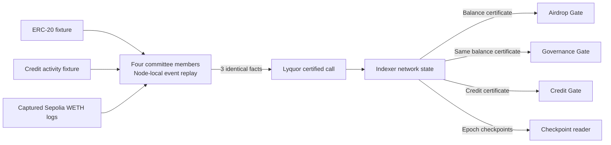

# HolderProof and VeriCredit-Idx

**CS5298 Final Project Report · First draft · 22 November 2026**

Source and reproduction instructions are available in the [public HolderProof repository](https://github.com/jerryluo0517-cyber/holderproof). The design follows the 3-of-4 implementation introduced on [main at `c11e69c`](https://github.com/jerryluo0517-cyber/holderproof/tree/c11e69c).

## Abstract

HolderProof turns historical ERC-20 holdings and protocol activity into facts that applications can reuse. Committee members replay the same ordered events, and Lyquor certifies a fact once at least three of four configured members agree on its full contents. An Airdrop Gate and a Governance Gate consume the same balance certificate while applying different eligibility rules. VeriCredit-Idx extends the design to credit scores and policy quotes derived from a window of activity. The prototype also certifies periodic fixture checkpoints and replays a bounded Sepolia WETH snapshot. This draft reports current automated checks and earlier end-to-end results with their corresponding committee configurations.

## 1. Problem Analysis

An airdrop may use a holder’s balance at a snapshot block to decide eligibility. A governance application may use the same balance with a higher threshold. A current balance cannot answer either historical question. An archival RPC provider can serve historical contract state, but every application needs a policy for choosing the provider, specifying the block and handling outages. When an indexer serves both applications, its API also needs a way to show where a result came from and what computation it represents.

The project starts with two questions. Can multiple members independently derive the same historical result from a fixed input, and can applications enforce their own policies using one certified copy of that result? The first requires agreement on the query, input range and parsing rules. The second requires a certificate that binds the answer to those inputs, along with a way for the consumer to identify its issuer. An application should also see whether a certificate is still valid at the time it records an action.

ERC-20 specifies the `Transfer` event and the `balanceOf` interface. For the fixture token, deterministic replay updates balances by crediting recipients and debiting senders through the requested block, including transfers at that block. This permits an independent comparison with historical `balanceOf` on a separate EVM ledger. The Sepolia extension poses a different question because its input starts at a later block. Its answer is the result of replaying the captured window with a zero opening balance. [ERC-20 standard](https://eips.ethereum.org/EIPS/eip-20) · [Ethereum JSON-RPC](https://ethereum.org/developers/docs/apis/json-rpc/)

## 2. Original Contribution

HolderProof’s contribution is the integration of deterministic historical replay, committee-certified facts and reusable policy decisions. A checkpoint records the dataset, range, boundary hashes, parser version, number of events and Merkle root. The certified balance fact binds that checkpoint to a particular query and result. The two balance gates share the validation code but keep their application policies and action records in separate Lyquids. For example, a balance of 62,685 satisfies an airdrop threshold of 60,000 while falling short of a governance threshold of 70,000.

VeriCredit-Idx applies the same pattern to a different fact. Its query binds a user, a block window and the scoring parameters. The resulting certificate carries activity metrics and a score, which a Credit Gate maps to a fee and loan-to-value (LTV) quote. A separate checkpoint topic certifies dataset-level summaries at selected blocks so a reader can compare commitments over time. These extensions reuse the oracle workflow while defining new input schemas and policy rules.

Lyquor supplies the certified-call protocol. ERC-20 event semantics, Merkle hashing and Byzantine quorum arithmetic are established techniques. The project implements replay, fact encoding, state layout and consumer policy on top of those mechanisms. [Lyquor certified calls](https://docs.lyquor.dev/docs/ldk/oracle/) · [Castro and Liskov, Practical Byzantine Fault Tolerance](https://pdos.lcs.mit.edu/6.824/papers/castro-practicalbft.pdf)

## 3. Technical Design

### 3.1 Data path and state

Instance state holds node-local replay and diagnostics. The Indexer writes certified balance and credit facts into shared network state, alongside epoch checkpoints. Each consuming Lyquid stores its own configuration and action records. The browser console displays built-in examples and imported evidence JSON. The CLI and running Lyquids execute the live query and policy path.

| Oracle topic | Input and output |
|---|---|
| `balance_proof` | Replays the fixture through a requested block and certifies a holder’s balance. |
| `credit_proof` | Replays activity within a window and certifies a user’s metrics and score for a given parameter set. |
| `checkpoint_proof` | Certifies an event count, cumulative volume, holder count and Merkle commitment through an epoch boundary. |
| `sepolia_proof` | Certifies a holder’s replay result for the captured WETH Transfer window. |

### 3.2 Certification and provenance

Each committee member derives a proposal. The Indexer excludes members that submit more than one proposal and requires at least three byte-identical facts from distinct eligible members. A balance fact contains the canonical query, replayed balance and checkpoint. The certified write persists the fact and native oracle evidence, which the exported certificate packages with the finalized status and signer information. The load path uses the same query hash to retrieve a cached certificate for a repeated query.

Two sets of three members drawn from a committee of four overlap in at least two members. Under an assumption of at most one faulty member, that intersection includes an honest member. For conflicting facts about the same certification instance, safety therefore depends on honest members approving one fact and Lyquor enforcing its certified-call rules. Progress requires three eligible members that can communicate and agree on the complete fact. The implementation also exposes an experimental dispersion check for time-skewed observations. Historical certificates use exact agreement on the bound historical data. [Lyquor certified calls](https://docs.lyquor.dev/docs/ldk/oracle/) · [Castro and Liskov, Practical Byzantine Fault Tolerance](https://pdos.lcs.mit.edu/6.824/papers/castro-practicalbft.pdf)

### 3.3 Applying a policy

The two balance gates obtain the certificate from the configured Indexer with a network-state `call!`. Shared validation checks status, query and checkpoint consistency, provenance and the correspondence of exported signer information to the native evidence. The gate compares the balance with its configured threshold in that call. A qualifying claim is recorded once per caller, and a qualifying vote is recorded once per proposal and caller. The gates fetch the certificate again when recording an action, so an earlier displayed decision does not authorize an action after revocation.

The Credit Gate uses a credit certificate. Its quote table assigns VIP to scores of at least 800, Standard to scores of 500–799, and Base to lower scores. These tiers correspond to a fee of 5, 15 or 30 basis points and an LTV of 85%, 75% or 60%, respectively. The `quote_or_fallback` path applies Base terms when a configured Indexer cannot supply a valid certificate or the certificate exceeds the configured age. These are demonstration policy parameters. [Balance certificate rules](../operations/step4-certificate.md) · [Credit Gate](../../lyquid-credit-gate/src/lib.rs)

## 4. Implementation

The workspace uses Rust and Lyquor LDK 0.8.4. [`holderproof-types`](../../holderproof-types/src/lib.rs) defines queries, facts, checkpoints and certificates. [`lyquid-indexer`](../../lyquid-indexer/src/lib.rs) handles replay, committee proposals and persistence. [`holderproof-gate-core`](../../holderproof-gate-core/src/lib.rs) holds the shared certificate and policy checks. The three application crates implement their own configuration, action or quote logic and diagnostic interfaces.

**Balance replay.** Replay processes transfers in block and log order. For a given holder, the prefix ending at the requested block determines the balance. Event leaves commit to event fields, including block and transaction position. A checkpoint extends that commitment with the dataset and parser identity. Fixture block hashes are deterministic synthetic values. The archival cross-check deploys a test token on a separate Anvil instance, replays the same transfers and maps fixture block numbers to the corresponding EVM blocks before reading balances. [Fixture replay](../../lyquid-indexer/src/fixture.rs) · [Historical EVM comparison](../../scripts/verify_historical_balance.py)

**Credit replay.** The 40-event synthetic dataset contains buys, sells, repayments and liquidations. For a selected user, the algorithm matches amounts from opposite-direction swaps against the same counterparty within the configured wash window. The unmatched amounts form clean volume. With clean volume `V`, repayment count `R` and liquidation count `L`, the score is the integer quotient of `w1 × floor(log2(1 + V)) + w2 × R` and `1 + alpha × L`, capped at 1,000. Defaults are `w1 = 35`, `w2 = 20`, `alpha = 2` and a wash window of three blocks. The calculation uses integer arithmetic so members can reproduce the same result. [Credit replay](../../lyquid-indexer/src/credit.rs) · [Credit fixture answers](../../fixtures/credit_expected.json)

**Epoch checkpoints.** A script requests checkpoints at fixture blocks 250, 500, 750 and 1000. Members compute summaries from the event prefix, certify them through the checkpoint topic and store the result in network state. This workflow demonstrates a periodic checkpoint schedule driven by the operator’s script. [Epoch verification](../../scripts/verify_epoch_checkpoints.py)

**Sepolia replay.** A fetch script retrieves WETH `Transfer` logs in pages and records the boundary block hashes. The repository contains 169 normalized events spanning blocks 12,184,050–12,184,649. Nodes replay these embedded events with the recorded parser and boundary metadata. The sample’s zero-opening-balance replay gives 0.002 WETH. The accompanying fixture also records a separately queried latest balance. [Ethereum log method](https://ethereum.github.io/execution-apis/api/methods/eth_getLogs/) · [Sepolia snapshot metadata](../../fixtures/sepolia_expected.json) · [Sepolia replay](../../lyquid-indexer/src/sepolia.rs)

## 5. Evaluation and Results

We assess whether replay agrees with an independent ledger, whether applications share one result, whether a usable certificate requires a quorum and how long the query takes. The local commands and expected outputs are documented in the [testing guide](../guides/TESTING.md). The measurements below identify the code or committee configuration under which they were collected.

| Evidence | Version | Result |
|---|---|---|
| Fixture verification, Python tests and locked workspace compile | 3-of-4 integration based on `c11e69c` | 9 fixture checks and 6 Python tests passed. The Rust workspace compiled with the lockfile. |
| Guest unit tests | 3-of-4 integration based on `c11e69c` | 21 Indexer and 15 Gate Core tests passed, covering replay, quorum, certificate evidence, scoring and tier policy. |
| Local archival EVM comparison | `be9560d`, 2-of-3 | All 308 Transfer logs and 18 historical balance reads matched. |
| End-to-end policy and availability check | `be9560d`, 2-of-3 | Both gates tracked the same certified query. An eligible action could be recorded once. Certification continued with one committee member paused, waited with two paused and resumed after recovery. |
| User 1 terminal operation | 2-of-3 | Alice’s fixture balance at block 1000 was 62,685. The certificate was `Finalized`, with two signers and a checkpoint covering 308 events. |
| Query timing | `db1532f`, 2-of-3 | Five serial first-time queries on a warm local network had a median of 58.10 ms from submission to readable certificate. Median certification time was 34.22 ms. |

The fixture and archival EVM results compare balances from two execution paths. The EVM token executes the transfers, while the Indexer derives balances from event data. This checks arithmetic and historical boundaries under the fixture’s token model. The 2-of-3 gate test compared the returned query identifiers as well as the policy outcomes. User 1’s terminal record independently records the expected balance, checkpoint event count and Merkle root for one query. That record contains the certificate fields and signer list. The two gate outcomes and timing measurements come from the team’s automated evaluation. [Plan 05 audit](PLAN_05_E3_AUDIT.md) · [User 1 and benchmark records](PLAN_06_MEMBER_EVALUATION.md)

Under default scoring, the credit fixture expects Alice, Bob, Carol and Dave to score 940, 495, 250 and 675. Bob’s raw volume of 2,015,000 includes 2,000,000 units matched as short-window reversals, leaving 15,000 eligible units and a Base quote. This is a controlled check of the matching rule. The Sepolia metadata provides a separate real-log input case. The live 3-of-4 acceptance, credit quotes, epoch verification and Sepolia certification still require fresh recorded runs for the report.

The earlier latency measurements capture a warm network on one machine with five queries. The report should add 3-of-4 timing under the same measurement definition before comparing configurations. The usability section currently contains one internal walkthrough. The [external test task sheet](../guides/EXTERNAL_USER_TEST.md) calls for at least three people outside the team to record setup effort, certificate results, gate decisions and any assistance.

## 6. Limitations and Reflection

**Input coverage.** A Merkle root commits to the included events. Establishing input completeness requires a trusted acquisition process, boundary hashes and an appropriate finality policy. Fixture replay assumes a token whose balances follow the recorded transfer history. A general deployment needs explicit support for tokens with other balance mechanics, as well as a way to account for balances before a partial capture window.

**Shared assumptions.** The local committee uses processes on one machine and replays copies of the same input. This setup checks application-level replay and quorum behavior. Operator independence, failures across hosts, independent RPC sources and broader network conditions remain to be evaluated. A shared parsing or acquisition error can make several honest members agree on an incorrect fact.

**Policy scope.** Credit tiers illustrate how a downstream application can use a certified score. Short-window same-counterparty matching covers a specific pattern, and its success on synthetic activity provides no estimate of real-world credit risk. Fixed thresholds and weights require independent calibration before use for financial decisions.

**Reproduction experience.** The CLI provides traceable commands and state. It also depends on compatible Rust, Lyquor and Foundry installations and available ports. The standalone console is an easier way to inspect examples and exported evidence. External walkthroughs will show which setup steps and certificate fields need clearer instructions.

## 7. Contributions and Attribution

The project work spans replay and data validation, oracle and state integration, the three policy gates, credit and Sepolia extensions, tests and documentation. Each team member should confirm their name, responsibilities and supporting commits or artifacts before submission. The User 1 record is an internal evaluation artifact. It documents a terminal operation and does not assign ownership of implementation work. [Repository history](https://github.com/jerryluo0517-cyber/holderproof/commits/main/)

The prototype uses Rust, Lyquor LDK, Python and Foundry/Anvil. Section 2 credits the certified-call protocol and underlying standards. The team repository stores the synthetic datasets and checked-in Sepolia snapshot used for reproduction. [Lyquor build, deploy and test documentation](https://docs.lyquor.dev/docs/ldk/build-deploy-test/) · [Foundry Anvil documentation](https://www.getfoundry.sh/anvil/index.html)

## 8. AI Use Statement

OpenAI Codex assisted with certificate-code readability, document editing, repository inspection, running automated checks and drafting this report. The team supplied the project direction and User 1’s terminal output. Draft claims were checked against the source, committed fixture answers, test outputs and the recorded earlier evaluations. Results are attributed to the corresponding configuration. Before submission, members should review the technical claims, confirm their contributions and disclose any additional AI tools and tasks from their own work.
